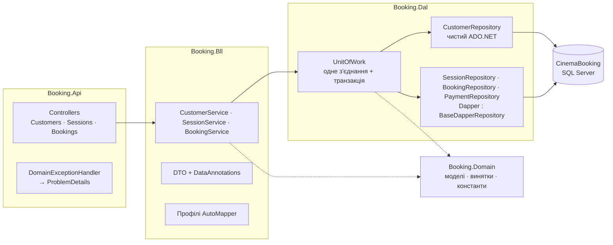
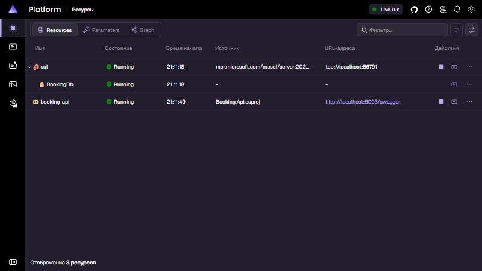
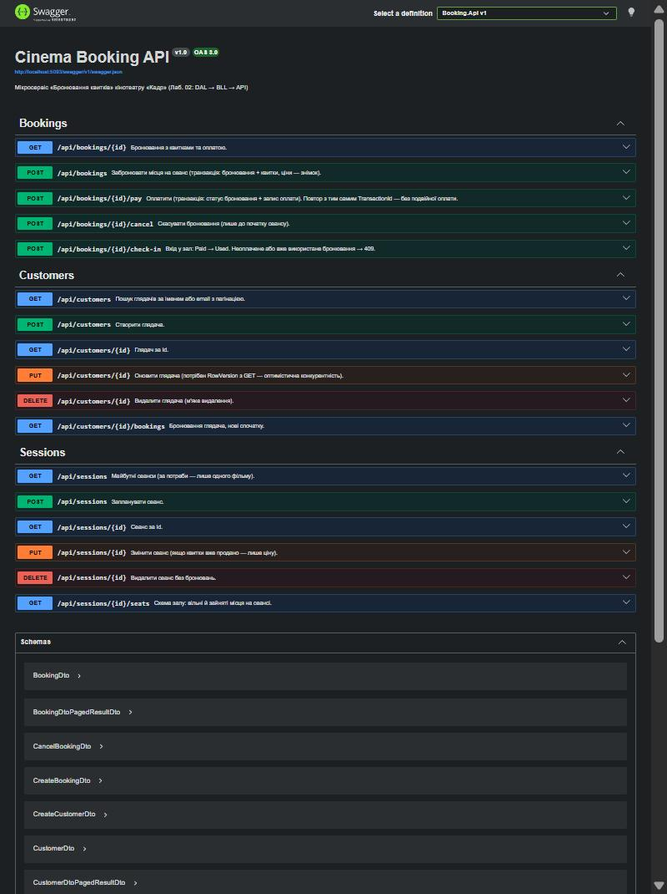
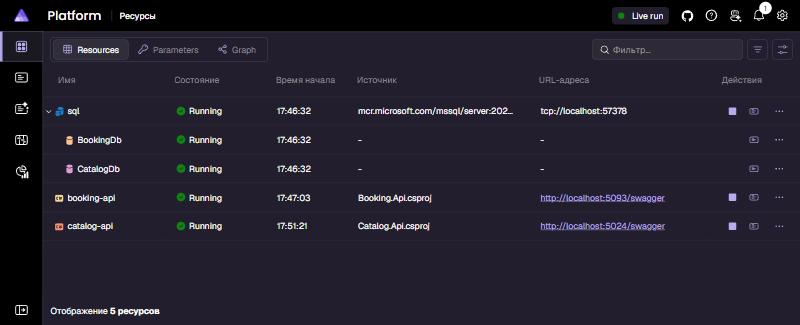
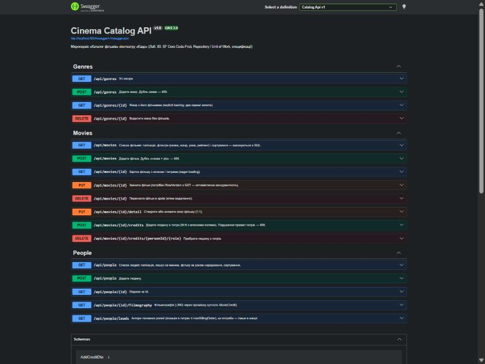
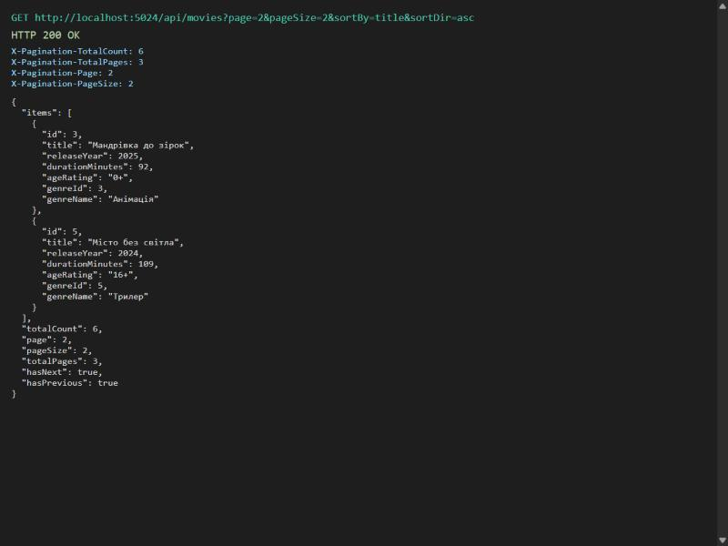
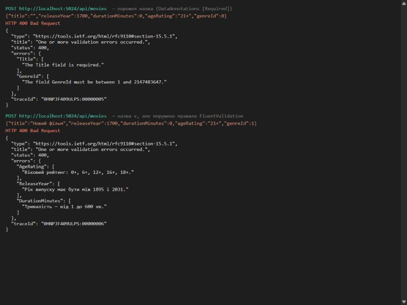

# Кінотеатр «Кадр» — мікросервісна платформа на .NET

* **Лаб. 01** — три бази даних для мікросервісів (розділи нижче, від «Що де лежить»).
* **Лаб. 02** — мікросервіс «Бронювання» як вертикаль DAL → BLL → API на ADO.NET + Dapper із запуском через .NET Aspire: розділ «Лаб. 02».
* **Лаб. 03** — мікросервіс «Каталог» на EF Core: Code-First, Fluent API, міграції, Repository / Unit of Work, специфікації, FluentValidation, Serilog: розділ «Лаб. 03» в кінці файлу.

**Домен.** Кінотеатр «Кадр» (вигаданий, 2 зали) продає квитки онлайн. Глядачі дивляться афішу, бронюють і оплачують місця на сеанс, а після перегляду пишуть відгуки й обговорюють фільми. Адміністратор веде каталог фільмів і розклад.

| № | Контекст (мікросервіс) | БД | Технологія | Сутності / колекції |
|---|---|---|---|---|
| 1 | **Бронювання квитків** | `CinemaBooking` | SQL Server + процедури (ADO.NET & Dapper — Лаб. 02) | Customers, Movies (копія), Halls, Seats, Sessions, Bookings, BookingPayments, Tickets |
| 2 | **Каталог фільмів** | `CinemaCatalog` | SQL Server + EF Core Code First | Genres, Movies, MovieDetails, People, MovieCredits |
| 3 | **Відгуки та обговорення** | `cinema_reviews` | MongoDB | reviews, discussions, messages, movieRatings |

Між базами немає жодного FOREIGN KEY: посилання на чужу сутність — звичайне поле з її Id. Детально: [docs/01-domain-and-contexts.md](docs/01-domain-and-contexts.md).

## Що де лежить

```
README.md                  опис домену, розгортання, таблиця дублювання
docs/                      опис контекстів, ERD (Mermaid + .dbml), приклади документів MongoDB (samples/*.json)
db/
├── p1/                    Проєкт №1 — CinemaBooking (SQL Server)
│   ├── schema.sql         БД, таблиці, ключі, обмеження, індекси, представлення
│   ├── procedures.sql     6 збережуваних процедур (CRUD + бізнес-операції)
│   ├── seed.sql           тестові дані (ідемпотентно)
│   ├── security.sql       логін застосунку booking_app, найменші привілеї
│   ├── queries.sql        запити: пагінація, пошук, розклад, схема залу
│   └── verify.sql         перевірки: CRUD, обмеження, переходи статусів, FK, права
├── p2/                    Проєкт №2 — CinemaCatalog (SQL Server, схема EF Core)
│   ├── schema.sql         БД, 5 сутностей, ключі, обмеження, індекси
│   ├── seed.sql           довідникові дані (ідемпотентно)
│   └── security.sql       логін застосунку catalog_app
└── p3/                    Проєкт №3 — cinema_reviews (MongoDB)
    ├── collections.js     колекції з JSON Schema Validation + індекси
    ├── seed.js            тестові документи (ідемпотентно, upsert)
    └── queries.js         запити й агрегації
scripts/deploy.ps1         розгортання всіх трьох БД однією командою
Platform.slnx              одне рішення на всю платформу
Platform.AppHost/          оркестрація .NET Aspire (AppHost.cs)
Services/Booking/          мікросервіс «Бронювання» (Проєкт №1, Лаб. 02): Booking.Api · Booking.Bll · Booking.Dal · Booking.Domain · Booking.Tests
Services/Catalog/          мікросервіс «Каталог» (Проєкт №2, Лаб. 03): Catalog.Api (+ Dockerfile) · Catalog.Bll · Catalog.Dal · Catalog.Domain · Catalog.Tests
```

| Артефакт | Файл |
|---|---|
| Опис домену, контексти, агрегати, вибір ключів | [docs/01-domain-and-contexts.md](docs/01-domain-and-contexts.md) |
| Проєкт №1: ERD, зв'язки, індекси, процедури | [docs/02-booking-db.md](docs/02-booking-db.md), [docs/erd/booking.dbml](docs/erd/booking.dbml) |
| Проєкт №2: ERD, Fluent API, seed, міграції | [docs/03-catalog-db.md](docs/03-catalog-db.md), [docs/erd/catalog.dbml](docs/erd/catalog.dbml) |
| Проєкт №3: колекції, моделювання, приклади документів, запити | [docs/04-reviews-db.md](docs/04-reviews-db.md), [docs/samples](docs/samples) |

ERD у форматі dbdiagram.io: відкрийте https://dbdiagram.io/d і вставте вміст `.dbml`-файлу.

## Політика дублювання даних

| Поле | Де зберігається | Джерело (власник) | Політика узгодженості |
|---|---|---|---|
| `Movies.Title`, `DurationMinutes`, `AgeRating` | CinemaBooking (локальна копія довідника) | `Movies` у CinemaCatalog | **копія**, оновлюється подіями з Каталогу (механізм — Лаб. 08) |
| `Bookings.MovieTitle`, `Bookings.SessionStartsAt` | CinemaBooking | `Movies` (копія) / `Sessions` | **знімок** на момент бронювання — не оновлюється (це те, що надруковано на квитку) |
| `Tickets.Price` | CinemaBooking | `Sessions.BasePrice` × тип місця | **знімок** ціни на момент бронювання — не оновлюється |
| `reviews.movieTitle`, `discussions.movieTitle`, `movieRatings.movieTitle` | cinema_reviews | `Movies` у CinemaCatalog | **копія**, оновлюється подіями з Каталогу (запит 9 у `db/p3/queries.js` показує оновлення) |
| `reviews.author.customerId`, `messages.author.customerId` | cinema_reviews | `Customers.Id` у CinemaBooking | лише **ідентифікатор**, без FK |
| `reviews.author.displayName`, `comments[].author` | cinema_reviews | `Customers.FullName` у CinemaBooking | **знімок** підпису на момент публікації — не оновлюється |
| `movieRatings.average`, `count`, `distribution` | cinema_reviews | `reviews` (та сама БД) | **проєкція**, перераховується агрегацією `$merge` |

Немає даних, які незалежно редагуються в двох сервісах (dual write). Змінити назву фільму може лише Каталог.

## Розгортання з нуля

Потрібно: **Docker Desktop** (з WSL 2) і **.NET SDK 10**.

**Автоматично (усі три БД однією командою):**

```bash
powershell -ExecutionPolicy Bypass -File scripts\deploy.ps1
```

Скрипт виконує кроки нижче і **запускає seed удруге**, щоб показати, що дублікати не з'являються.

**Вручну, по кроках** (порядок важливий):

1. Запустити контейнери: SQL Server 2022 на `1433`, MongoDB 7 на `27017`. Папка `db/` монтується в контейнери як `/scripts`.
   ```bash
   docker compose up -d --wait
   ```
2. **Проєкт №1:** `p1/schema.sql` → `p1/procedures.sql` → `p1/seed.sql` → `p1/security.sql`. Для кожного файлу (змініть шлях):
   ```bash
   docker exec cinema-sql /opt/mssql-tools18/bin/sqlcmd -S localhost -U sa -P "Cinema_Dev_2026!" -C -I -b -W -f 65001 -i /scripts/p1/schema.sql
   ```
3. **Проєкт №2:** `p2/schema.sql` → `p2/seed.sql` → `p2/security.sql` (та сама команда `sqlcmd`).
   Це проєкт схеми з Лаб. 01. Робоча БД мікросервісу «Каталог» (Лаб. 03) створюється міграціями EF Core — див. розділ «Лаб. 03».
4. **Проєкт №3:** `p3/collections.js` → `p3/seed.js`:
   ```bash
   docker exec cinema-mongo mongosh --quiet /scripts/p3/collections.js
   ```

`schema.sql` обох SQL-проєктів створює БД з нуля, тому розгортання можна повторювати. `seed.*` можна запускати скільки завгодно разів: дублікатів не буде.

## Облікові записи

| Що | Логін | Пароль | Доступ |
|---|---|---|---|
| SQL Server, адміністратор | `sa` | `Cinema_Dev_2026!` | усе |
| Застосунок Бронювання | `booking_app` | `Kadr_Tickets#2026` | лише CinemaBooking: процедури, CRUD глядачів без DELETE |
| Застосунок Каталогу | `catalog_app` | `Kadr_Films#2026` | лише CinemaCatalog: читання/запис даних, без зміни схеми |
| MongoDB | — | — | без автентифікації (локальна розробка) |

Паролі навчальні. У реальному проєкті вони зберігаються в секретах, а не в репозиторії.

**SSMS:** сервер `localhost,1433`, «Проверка подлинности SQL Server», `sa` / пароль, ✅ «Доверенный сертификат сервера».
**MongoDB Compass:** `mongodb://localhost:27017`. Якщо на ПК встановлено ще й локальний MongoDB (служба `MongoDB`), він перехоплює `localhost`. Тоді використовуйте `mongodb://[::1]:27017` або зупиніть службу.

## Перевірка

| Що | Команда |
|---|---|
| Проєкт №1: CRUD-процедури, обмеження, недопустимі переходи, конкурентність, FK, права | `docker exec cinema-sql /opt/mssql-tools18/bin/sqlcmd -S localhost -U sa -P "Cinema_Dev_2026!" -C -I -W -f 65001 -i /scripts/p1/verify.sql` |
| Проєкт №1: пошук, пагінація, розклад, схема залу | та сама команда з `/scripts/p1/queries.sql` |
| Повторний seed без дублікатів | та сама команда з `/scripts/p1/seed.sql` або `/scripts/p2/seed.sql`: таблиця кількостей не змінюється; `mongosh … /scripts/p3/seed.js` → «додано 0» |
| Проєкт №2: міграції, сідінг і запити EF Core | див. розділ «Лаб. 03» |
| Проєкт №3: агрегації, embedding/reference, валідація | `docker exec cinema-mongo mongosh --quiet /scripts/p3/queries.js` |

**Самоперевірка з умови:**
* `SELECT * FROM sys.foreign_keys` у кожній SQL-базі — усі FK ведуть на таблиці тієї ж бази (розділ 7 у `db/p1/verify.sql`).
* «Використати» неоплачене бронювання → `50002 Недопустимий перехід статусу: Created -> Used` (розділ 5).
* `db.reviews.find()` повертає документи з різними наборами полів (`quick` / `full` / `critic`).
* Поля з таблиці дублювання не мають FK на іншу базу; знімки позначені коментарями в DDL.

Скинути все й почати з нуля:

```bash
docker compose down -v
```

---

## Лаб. 02 — мікросервіс Booking (ADO.NET + Dapper, Aspire)

Вертикаль від бази Проєкту №1 (`CinemaBooking`, скрипти `db/p1`) до REST API: **DAL → BLL → Web/API**, Unit of Work з транзакціями, DTO + AutoMapper, ProblemDetails, Swagger, запуск через .NET Aspire.

### Що потрібно

* **.NET SDK 10**, **Docker Desktop** (запущений; WSL 2).
* AutoMapper ≥ 15 має комерційну ліцензію з безкоштовною Community-редакцією: ключ з https://automapper.io вписується в `Services/Booking/Booking.Api/appsettings.json` → `AutoMapper:LicenseKey`. Без ключа все працює, лише в лог пишеться попередження.
* **Windows із Smart App Control = On** блокує непідписані DLL, зібрані локально (журнал `CodeIntegrity`, подія 3077, політика `VerifiedAndReputableDesktop`). Тоді API не стартує ні через Aspire, ні через `dotnet run`. Варіанти: вимкнути Smart App Control (Безпека Windows → Керування застосунками та браузером) або запускати API в контейнері (нижче).

### Запуск однією командою (Aspire)

```bash
dotnet run --project Platform.AppHost
```

Dashboard: http://localhost:15180 (посилання з токеном входу — у консолі). AppHost піднімає **SQL Server у контейнері** (ресурс `sql`), створює БД `CinemaBooking` зі скриптів `db/p1` (schema → procedures → seed → security) і запускає **`booking-api`** з рядком підключення `BookingDb`. Повне посилання на Dashboard з токеном з'являється в консолі (`Login URL: http://localhost:15180/login?t=…`). У Dashboard обидва ресурси мають статус **Running**, а в рядку `booking-api` є посилання на `/swagger`.

> Ім'я ресурсу бази `BookingDb` = ім'я рядка підключення в `appsettings.json`, тому Aspire передає його в API як `ConnectionStrings__BookingDb` без змін у коді API. БД у контейнері Aspire щоразу створюється заново, тож тестові сеанси завжди «завтра».

### Запуск без Aspire

```bash
docker compose up -d --wait
```

```bash
dotnet run --project Services/Booking/Booking.Api
```

Swagger: http://localhost:5093/swagger. API підключається до `localhost,1433` під логіном застосунку `booking_app` (найменші привілеї, `db/p1/security.sql`). Рядок підключення перевизначається змінною `ConnectionStrings__BookingDb`.

API в Linux-контейнері (обхід Smart App Control; БД — `cinema-sql` з docker compose; запускати з кореня репозиторію в cmd):

```bash
docker run --rm -it --network project_default -p 5095:8080 -v "%cd%:/src:ro" -e ASPNETCORE_ENVIRONMENT=Development -e ASPNETCORE_URLS=http://+:8080 -e "ConnectionStrings__BookingDb=Server=cinema-sql,1433;Database=CinemaBooking;User Id=booking_app;Password=Kadr_Tickets#2026;TrustServerCertificate=True" mcr.microsoft.com/dotnet/sdk:10.0 sh -c "mkdir /work && cd /src && tar --exclude=bin --exclude=obj -cf - Services Directory.Build.props global.json | tar -xf - -C /work && cd /work/Services/Booking/Booking.Api && dotnet run --no-launch-profile"
```

### Схема рішення



| Проєкт | Вміст |
|---|---|
| `Booking.Domain` | моделі таблиць (`Customer`, `Session`, `Booking`, `Ticket`, `BookingPayment`…), доменні винятки `NotFoundException` / `BusinessConflictException` / `ValidationException`, константи статусів |
| `Booking.Dal` | `IGenericRepository<T>` і конкретні інтерфейси; `CustomerRepository` (**чистий ADO.NET**, свідомо без Generic Repository); `SessionRepository`, `BookingRepository`, `PaymentRepository` (**Dapper**, спільний CRUD у `BaseDapperRepository<T>`); `UnitOfWork`; `SqlErrorTranslator` (SqlException → доменні винятки) |
| `Booking.Bll` | сервіси, DTO з валідацією, профілі AutoMapper |
| `Booking.Api` | тонкі контролери з атрибутною маршрутизацією, `DomainExceptionHandler`, Serilog, Swagger |
| `Booking.Tests` | unit-тести BLL (NSubstitute) + `AssertConfigurationIsValid` для AutoMapper |

Залежності в один бік: **Api → Bll → Dal**; `Domain` бачать і Dal, і Bll. Контролери не мають SQL і бізнес-правил. Увесь SQL лежить лише в `Booking.Dal`, усі значення передаються параметрами.

### Ендпоінти

| Метод | Шлях | Що робить | Статуси |
|---|---|---|---|
| GET | `/api/customers?search=&page=&pageSize=` | пошук глядачів з пагінацією | 200 |
| GET | `/api/customers/{id}` | глядач | 200, 404 |
| POST | `/api/customers` | створити | 201 + Location, 400, 409 (дубль email) |
| PUT | `/api/customers/{id}` | оновити (потрібен `rowVersion` з GET) | 200, 400, 404, 409 (конфлікт версій) |
| DELETE | `/api/customers/{id}` | м'яке видалення | 204, 404, 409 (є активні бронювання) |
| GET | `/api/customers/{id}/bookings` | бронювання глядача | 200, 404 |
| GET | `/api/sessions?movieId=` | майбутні сеанси | 200 |
| GET | `/api/sessions/{id}` · `/api/sessions/{id}/seats` | сеанс · схема залу | 200, 404 |
| POST · PUT · DELETE | `/api/sessions` · `/api/sessions/{id}` | CRUD розкладу | 201/200/204, 400, 404, 409 |
| GET | `/api/bookings/{id}` | бронювання з квитками й оплатою | 200, 404 |
| POST | `/api/bookings` | **забронювати** (транзакція) | 201 + Location, 400, 404, 409 (місце зайняте, сеанс почався) |
| POST | `/api/bookings/{id}/pay` | **оплатити** (транзакція, 2 репозиторії, ідемпотентно) | 200, 400, 404, 409 |
| POST | `/api/bookings/{id}/cancel` | скасувати (процедура `usp_Booking_ChangeStatus`) | 204, 404, 409 |
| POST | `/api/bookings/{id}/check-in` | вхід у зал, Paid → Used (та сама процедура) | 204, 404, 409 |

### Транзакції, ізоляція, конкурентність

| Операція | Що змінюється в одній транзакції UoW | Захист від гонок |
|---|---|---|
| `BookingService.CreateAsync` | `Bookings` (знімок `MovieTitle`, `SessionStartsAt`, `TotalAmount`) + `Tickets` (знімок `Price`, VIP × 1.5) | `UPDLOCK, HOLDLOCK` на перевірці зайнятих місць + фільтрований UNIQUE `(SessionId, SeatId) WHERE IsCancelled = 0` |
| `BookingService.PayAsync` | репозиторій 1: `Bookings` (Created → Paid); репозиторій 2: `BookingPayments` | `UPDLOCK` на рядку бронювання (**песимістично**); `TransactionId` — ключ **ідемпотентності** (UNIQUE) |
| `CustomerService.UpdateAsync` | `Customers` | **оптимістично**: `WHERE RowVersion = @RowVersion` → 409 |

* **Рівень ізоляції — `ReadCommitted`.** Вищі рівні (`RepeatableRead`, `Serializable`) прибирають більше аномалій читання, але тримають ширші блокування, і під навантаженням зростає ризик взаємних блокувань (deadlock) та очікувань. Тому послаблений рівень поєднується з **точковими** блокуваннями лише там, де потрібна гарантія: місця сеансу, рядок бронювання при оплаті. Додатково страхують UNIQUE-індекси БД.
* **Таймаути:** `CommandTimeout = 30 с` для кожної команди (`RepositoryBase`) і `Command Timeout=30` у рядку підключення. Довге блокування краще обірвати помилкою, ніж тримати з'єднання з пулу.
* **Відкат:** будь-який виняток усередині операції викликає `RollbackAsync`. Якщо запит обірвано, `DisposeAsync` UoW закриває незафіксовану транзакцію.
* **Optimistic vs pessimistic.** Оплата одного бронювання двома запитами одночасно — реальний сценарій (подвійне натискання, повтор callback-у), тому тут блокування рядка. Редагування профілю глядача — рідкісний конфлікт, і для нього достатньо RowVersion.

### Ланцюжок помилок: процедура → DAL → BLL → HTTP

| Джерело | DAL (`SqlErrorTranslator`) | HTTP (`DomainExceptionHandler`) |
|---|---|---|
| `THROW 50001` у процедурі | `NotFoundException` | 404 |
| `THROW 50002…50007` (недопустимий перехід, сеанс почався, …) | `BusinessConflictException` | 409 |
| порушення UNIQUE (2601/2627), FK (547) | `BusinessConflictException` | 409 |
| бізнес-валідація в сервісі | `ValidationException` | 400 |
| DataAnnotations на DTO | — (відхиляється до сервісу) | 400 `ValidationProblemDetails` |
| будь-що інше | — | 500 без внутрішніх подробиць |

Усі помилки повертаються у форматі **ProblemDetails** (RFC 9457) з `traceId`. Serilog пише один рядок логу на запит із `RequestId`, без секретів.

### Приклади запитів

У PowerShell використовуйте `curl.exe` (не аліас `curl`). Тіло з кирилицею надсилайте через Swagger / Postman або з файлу в UTF-8.

Створити глядача (201 + `Location`; апостроф безпечний, бо значення передаються лише параметрами):

```bash
curl -i -X POST http://localhost:5093/api/customers -H "Content-Type: application/json" -d "{\"fullName\":\"Sean O'Brien\",\"email\":\"obrien@example.com\"}"
```

Забронювати два місця на сеанс 2 (201):

```bash
curl -i -X POST http://localhost:5093/api/bookings -H "Content-Type: application/json" -d "{\"customerId\":2,\"sessionId\":2,\"seatIds\":[25,26]}"
```

**Відкат транзакції.** Оплата нового бронювання з `TransactionId`, що вже належить бронюванню №1, дає 409. Статус лишається `Created`, оплата не створюється:

```bash
curl -i -X POST http://localhost:5093/api/bookings/5/pay -H "Content-Type: application/json" -d "{\"amount\":360,\"method\":\"card\",\"transactionId\":\"SEED-TXN-0001\"}"
```

```bash
curl http://localhost:5093/api/bookings/5
```

Коректна оплата (200; повтор із тим самим `transactionId` не оплачує вдруге):

```bash
curl -X POST http://localhost:5093/api/bookings/5/pay -H "Content-Type: application/json" -d "{\"amount\":360,\"method\":\"card\",\"transactionId\":\"TXN-0005\"}"
```

Вхід у зал: перший раз 204, повторно **409** ProblemDetails (`Used -> Used`):

```bash
curl -i -X POST http://localhost:5093/api/bookings/5/check-in
```

Неіснуючий Id повертає **404**, а не 500:

```bash
curl -i http://localhost:5093/api/customers/999
```

### Тести

```bash
dotnet test --project Services/Booking/Booking.Tests
```

15 тестів:
- конфігурація AutoMapper;
- валідація DTO не залежить від культури ОС (uk-UA / en-US);
- «оплата неіснуючого → NotFound»;
- «помилка в другому репозиторії → Rollback без Commit»;
- ідемпотентність оплати;
- знімок назви й цін при бронюванні;
- зайняте місце / сеанс почався → Conflict;
- конфлікт RowVersion;
- видалення глядача з активними бронюваннями.

### Самоперевірка з умови

| Перевірка | Як | Результат |
|---|---|---|
| значення зі спецсимволом | POST глядача `Sean O'Brien` | 201, жодної SQL-помилки |
| помилка в другому репозиторії відкочує перший | оплата з чужим `TransactionId` | 409, статус лишився `Created` |
| повторний перехід статусу → 409 | `check-in` двічі | 409 ProblemDetails |
| неіснуючий Id → 404 | `GET /api/customers/999` | 404 ProblemDetails |
| AppHost: API і база Running | `dotnet run --project Platform.AppHost` | Dashboard |
| кожен ендпоінт у `/swagger` | Swagger UI | статуси з таблиці вище |

### Знімки екрана

Aspire Dashboard — `sql`, `BookingDb`, `booking-api` у статусі Running:



Swagger — перелік ендпоінтів:



---

## Лаб. 03 — мікросервіс Catalog (EF Core, Code-First)

Мікросервіс «Каталог фільмів» (Проєкт №2 з Лаб. 01) із тією самою будовою, що й Booking, але доступ до даних — на **EF Core**:
- моделі й Fluent API, міграції, LINQ to Entities;
- Async Generic Repository + 3 специфічні репозиторії + Unit of Work;
- специфікації (Ardalis.Specification);
- DTO + AutoMapper, DataAnnotations + FluentValidation;
- ProblemDetails, Serilog.

### Що потрібно

**.NET SDK 10** і **Docker Desktop**. Інструмент `dotnet-ef` прописано в локальному маніфесті (`dotnet-tools.json`), достатньо виконати:

```bash
dotnet tool restore
```

### Запуск

**Через Aspire (рекомендовано)** — SQL Server, обидві БД, Booking.Api і Catalog.Api однією командою:

```bash
dotnet run --project Platform.AppHost
```

`catalog-api` на старті сам застосовує міграції (`MigrateAsync`) до порожньої БД `CinemaCatalog` і запускає ідемпотентний сідінг. Swagger: http://localhost:5024/swagger. Dashboard: http://localhost:15180.

**Окремо, проти SQL Server з docker compose:**

```bash
docker compose up -d --wait sqlserver
```

```bash
dotnet run --project Services/Catalog/Catalog.Api
```

Рядок підключення `CatalogDb` (`appsettings.json`) веде на окрему БД `CinemaCatalogEf`. Її створюють міграції, а `CinemaCatalog` з docker compose — це SQL-проєкт схеми з Лаб. 01. Перевизначення: `ConnectionStrings__CatalogDb`.

**Docker-образ:**

```bash
docker build -f Services/Catalog/Catalog.Api/Dockerfile -t cinema-catalog-api .
```

### Міграції

Міграції лежать у [`Services/Catalog/Catalog.Dal/Migrations`](Services/Catalog/Catalog.Dal/Migrations): `InitialCreate` + знімок моделі. SQL-скрипт — [`Migrations/Scripts/InitialCreate.sql`](Services/Catalog/Catalog.Dal/Migrations/Scripts/InitialCreate.sql). DbContext — у `Catalog.Dal`, рядок підключення — у `Catalog.Api`, тому вказуються обидва проєкти.

```bash
dotnet ef migrations add <НазваЗміни> --project Services/Catalog/Catalog.Dal --startup-project Services/Catalog/Catalog.Api -o Migrations
```

```bash
dotnet ef database update --project Services/Catalog/Catalog.Dal --startup-project Services/Catalog/Catalog.Api
```

```bash
dotnet ef migrations script --idempotent --project Services/Catalog/Catalog.Dal --startup-project Services/Catalog/Catalog.Api -o Services/Catalog/Catalog.Dal/Migrations/Scripts/InitialCreate.sql
```

### Будова

| Проєкт | Вміст |
|---|---|
| `Catalog.Domain` | сутності `Genre`, `Movie`, `MovieDetail` (1:1), `Person`, `MovieCredit` (M:N з полями `Role`, `CharacterName`, `BillingOrder`, `CreditedAt`). Приватні setter-и, валідація в конструкторах, зміни лише методами (`ChangeDuration`, `SetDetail`, `AddCredit`, `RemoveCredit`, `Archive`). Винятки `DomainException`, `EntityNotFoundException`, `ConflictException`, `ValidationException` |
| `Catalog.Dal` | `CatalogDbContext` (`ApplyConfigurationsFromAssembly`), `Configurations/` (окремий `IEntityTypeConfiguration<T>` на кожну сутність: таблиці, ключі, довжини, `decimal(18,2)`, UNIQUE, CHECK, зв'язки, `HasData` жанрів), `Migrations/`, `GenericRepository<T>`, 3 специфічні репозиторії, `UnitOfWork`, `Seeding/DbInitializer` |
| `Catalog.Bll` | сервіси (`MovieService`, `GenreService`, `PersonService`), DTO, `Specifications/` (`MoviesFilterSpec`, `PeopleFilterSpec`), `Validators/` (FluentValidation), профілі AutoMapper |
| `Catalog.Api` | тонкі контролери, явний виклик валідаторів, `ExceptionToProblemDetailsHandler`, `CorrelationIdMiddleware`, Serilog, Swagger, Dockerfile |
| `Catalog.Tests` | 24 тести: правила сутностей, специфікації в пам'яті, репозиторії на EF InMemory, сервіс, валідатори, AutoMapper |

### Репозиторії й Unit of Work

| Репозиторій | Спосіб завантаження | Специфічний запит |
|---|---|---|
| `GenericRepository<T>` | — | `GetByIdAsync`, `GetAllAsync`, `AddAsync` (async); `Update`, `Delete` (лише стан у контексті); `ListAsync(spec)`, `CountAsync(spec)` |
| `MovieRepository` | **Eager** — `Include(Genre).Include(Detail).Include(Credits).ThenInclude(Person)` | картка фільму **одним** SQL-запитом |
| `GenreRepository` | **Explicit** — `Entry(genre).Collection(g => g.Movies).Query()…LoadAsync()` | жанр, а потім його фільми **другим** запитом |
| `MovieCreditRepository` | **LINQ to Entities через проміжну сутність** | фільмографія (`MovieCredit → Movie → Genre` з полями зв'язку); головні ролі (фільтр за `Role`, `BillingOrder`) |

`UnitOfWork` об'єднує репозиторії над одним `DbContext` (Scoped). `SaveChangesAsync()` викликається **один раз** наприкінці бізнес-операції. Репозиторії самі нічого не зберігають. Помилки БД перетворюються на доменні: конфлікт RowVersion або UNIQUE → `ConflictException`.

Перевірено в лозі SQL ([`docs/screenshots/lab03-sql-eager-vs-explicit.log`](docs/screenshots/lab03-sql-eager-vs-explicit.log)): eager — **1** запит, explicit — **2**.

### Ендпоінти

| Метод | Шлях | Статуси |
|---|---|---|
| GET | `/api/movies?page=&pageSize=&search=&genreId=&yearFrom=&yearTo=&ageRating=&sortBy=title\|year\|duration&sortDir=asc\|desc` | 200, 400 |
| GET | `/api/movies/{id}` — картка (eager) | 200, 404 |
| POST | `/api/movies` | 201 + Location, 400, 409 (дубль «назва + рік») |
| PUT | `/api/movies/{id}` (з `rowVersion`) | 200, 400, 404, 409 |
| PUT | `/api/movies/{id}/detail` (1:1) | 200, 400, 404 |
| POST | `/api/movies/{id}/credits` (M:N) | 200, 400, 404, 409 (правила титрів) |
| DELETE | `/api/movies/{id}/credits/{personId}/{role}` | 204, 404, 409 |
| DELETE | `/api/movies/{id}` — в архів | 204, 404 |
| GET | `/api/genres` · `/api/genres/{id}` (explicit) | 200, 404 |
| POST · DELETE | `/api/genres` · `/api/genres/{id}` | 201 / 204, 400, 404, 409 |
| GET | `/api/people?page=&pageSize=&search=&bornFrom=&bornTo=&sortBy=name\|birthYear&sortDir=` | 200, 400 |
| GET · POST | `/api/people/{id}` · `/api/people` | 200 / 201, 400, 404 |
| GET | `/api/people/{id}/filmography` (M:N LINQ) | 200, 404 |
| GET | `/api/people/leads?genre=&maxBillingOrder=` (M:N LINQ) | 200, 400 |

### Пагінація, фільтрація, сортування

- **Запит:** `page` (з 1), `pageSize` (10 за замовчуванням, максимум 50), фільтри, `sortBy` / `sortDir`. Сортувати можна лише за полями з білого списку, інше — 400.
- **Відповідь:** `items`, `totalCount`, `page`, `pageSize`, `totalPages`, `hasNext`, `hasPrevious`. Ці ж метадані дублюються в заголовках `X-Pagination-TotalCount`, `X-Pagination-TotalPages`, `X-Pagination-Page`, `X-Pagination-PageSize`.
- **Реалізація:** `MoviesFilterSpec` / `PeopleFilterSpec` описують `Where`, `Include`, `OrderBy`, `Skip` / `Take`. Репозиторій застосовує їх через `WithSpecification()` — це один SQL `… ORDER BY … OFFSET … FETCH`. `CountAsync(spec)` рахує `COUNT(*)` за тими самими критеріями без пагінації. Обидві специфікації працюють через той самий `GenericRepository` без змін у ньому.

### Валідація та помилки

| Рівень | Що перевіряє | Відповідь |
|---|---|---|
| DataAnnotations на DTO | `Required`, `StringLength`, `Range` | 400 `ValidationProblemDetails` (автоматично) |
| FluentValidation (`Catalog.Bll/Validators`, явний виклик у контролерах) | рік випуску, тривалість, віковий рейтинг, формат RowVersion і URL, правила ролей у титрах, білий список сортування, `yearFrom ≤ yearTo` | 400 `ValidationProblemDetails` |
| Сервіси (BLL) | існування жанру / людини, унікальність «назва + рік», жанр без фільмів | 400 / 409 |
| Сутності (Domain) | інваріанти моделі | 409 `DomainException` |

`ExceptionToProblemDetailsHandler`:
- `EntityNotFoundException` → **404**;
- `ValidationException` → **400**;
- `ConflictException` / `DomainException` → **409**;
- решта → **500**, і подробиці віддаються лише в Development.

Кожен виняток логується один раз.

### Логування (Serilog)

Налаштування — розділ `Serilog` в [`appsettings.json`](Services/Catalog/Catalog.Api/appsettings.json):
- **sinks:** Console і File (`logs/catalog-*.json`, compact JSON, ротація щодня);
- **рівні:** Information за замовчуванням; `Microsoft.EntityFrameworkCore.Database.Command` = Information, тож у лог потрапляють SQL-запити EF Core;
- **властивості:** `CorrelationIdMiddleware` додає `CorrelationId` (заголовок `X-Correlation-Id` або згенерований, повертається у відповіді), `RequestPath`, `UserId`; `UseSerilogRequestLogging` пише один рядок на запит.

Рівні змінюються змінними оточення, наприклад `Serilog__MinimumLevel__Default=Warning`.

### Тести

```bash
dotnet test --project Services/Catalog/Catalog.Tests
```

### Самоперевірка з умови

| Перевірка | Результат |
|---|---|
| eager-репозиторій виконує 1 запит, explicit — 2 | ✅ [`lab03-sql-eager-vs-explicit.log`](docs/screenshots/lab03-sql-eager-vs-explicit.log) |
| POST з порожнім Title → 400 з помилками по полях | ✅ знімок нижче |
| повторне створення з тим самим «назва + рік» → 409; неіснуючий Id → 404 ProblemDetails | ✅ |
| `page=2&pageSize=2` → `totalCount` = усі записи (6), а не розмір сторінки | ✅ знімок нижче |
| повторний запуск не дублює seed-дані | ✅ у лозі «Seeding: дані каталогу вже є — пропущено», кількості 6 / 8 незмінні |
| друга специфікація (`PeopleFilterSpec`) працює через той самий репозиторій | ✅ `/api/people?...` |

### Знімки екрана (Лаб. 03)

Aspire Dashboard — `catalog-api` і `CatalogDb` у статусі Running:



Swagger Catalog API:



Відповідь з пагінацією (`page=2&pageSize=2`):



400 з помилками валідації (DataAnnotations і FluentValidation):


