# Кінотеатр «Кадр» — мікросервісна платформа на .NET

* **Лаб. 01** — три бази даних для мікросервісів (розділи нижче, від «Що де лежить»).
* **Лаб. 02** — мікросервіс «Бронювання» як вертикаль DAL → BLL → API на ADO.NET + Dapper із запуском через .NET Aspire: розділ «Лаб. 02».
* **Лаб. 03** — мікросервіс «Каталог» на EF Core: Code-First, Fluent API, міграції, Repository / Unit of Work, специфікації, FluentValidation, Serilog: розділ «Лаб. 03».
* **Лаб. 04** — мікросервіс «Відгуки» на MongoDB за Clean Architecture: CQRS + MediatR, Value Objects, Pipeline Behaviors, BsonClassMap, індекси й сідінг: розділ «Лаб. 04».
* **Лаб. 05** — усі три сервіси в одній платформі .NET Aspire: ServiceDefaults (Serilog + OpenTelemetry + CorrelationId), API Gateway на YARP, Aggregator: розділ «Лаб. 05».
* **Лаб. 06** — gRPC між Aggregator і сервісами, дворівневий кеш (IMemoryCache + Redis), кеш агрегованих відповідей, метрики кешу: розділ «Лаб. 06» в кінці файлу.

**Домен.** Кінотеатр «Кадр» (вигаданий, 2 зали) продає квитки онлайн. Глядачі дивляться афішу, бронюють і оплачують місця на сеанс, а після перегляду пишуть відгуки й обговорюють фільми. Адміністратор веде каталог фільмів і розклад.

| № | Контекст (мікросервіс) | БД | Технологія | Сутності / колекції |
|---|---|---|---|---|
| 1 | **Бронювання квитків** | `CinemaBooking` | SQL Server + процедури (ADO.NET & Dapper — Лаб. 02) | Customers, Movies (копія), Halls, Seats, Sessions, Bookings, BookingPayments, Tickets |
| 2 | **Каталог фільмів** | `CinemaCatalog` | SQL Server + EF Core Code First | Genres, Movies, MovieDetails, People, MovieCredits |
| 3 | **Відгуки та обговорення** | `cinema_reviews` | MongoDB | reviews, discussions, messages, movieRatings |

Між базами немає жодного FOREIGN KEY: посилання на чужу сутність — звичайне поле з її Id. Детально: [docs/01-domain-and-contexts.md](docs/01-domain-and-contexts.md).

## Що де лежить

```
README.md                  опис домену, розгортання, таблиця дублювання
docs/                      опис контекстів, ERD (Mermaid + .dbml), приклади документів MongoDB (samples/*.json)
db/
├── p1/                    Проєкт №1 — CinemaBooking (SQL Server)
│   ├── schema.sql         БД, таблиці, ключі, обмеження, індекси, представлення
│   ├── procedures.sql     6 збережуваних процедур (CRUD + бізнес-операції)
│   ├── seed.sql           тестові дані (ідемпотентно)
│   ├── security.sql       логін застосунку booking_app, найменші привілеї
│   ├── queries.sql        запити: пагінація, пошук, розклад, схема залу
│   └── verify.sql         перевірки: CRUD, обмеження, переходи статусів, FK, права
├── p2/                    Проєкт №2 — CinemaCatalog (SQL Server, схема EF Core)
│   ├── schema.sql         БД, 5 сутностей, ключі, обмеження, індекси
│   ├── seed.sql           довідникові дані (ідемпотентно)
│   └── security.sql       логін застосунку catalog_app
└── p3/                    Проєкт №3 — cinema_reviews (MongoDB)
    ├── collections.js     колекції з JSON Schema Validation + індекси
    ├── seed.js            тестові документи (ідемпотентно, upsert)
    └── queries.js         запити й агрегації
scripts/deploy.ps1         розгортання всіх трьох БД однією командою
Platform.slnx              одне рішення на всю платформу
Platform.AppHost/          оркестрація .NET Aspire (AppHost.cs): SQL Server, MongoDB і Redis з томами, сервіси, Aggregator, Gateway
Platform.ServiceDefaults/  спільні налаштування (Лаб. 05): Serilog, OpenTelemetry, CorrelationId, health checks, service discovery
Platform.ApiGateway/       API Gateway на YARP — єдина точка входу (http://localhost:5000)
Platform.Aggregator/       Aggregator Pattern: gRPC-клієнти трьох сервісів, кеш агрегатів у Redis (+ Platform.Aggregator.Tests)
Services/Booking/          мікросервіс «Бронювання» (Проєкт №1, Лаб. 02): Booking.Api (+ Protos/, Grpc/) · Booking.Bll · Booking.Dal · Booking.Domain · Booking.Tests
Services/Catalog/          мікросервіс «Каталог» (Проєкт №2, Лаб. 03): Catalog.Api (+ Dockerfile, Protos/, Grpc/) · Catalog.Bll (+ Caching/) · Catalog.Dal · Catalog.Domain · Catalog.Tests
Services/Reviews/          мікросервіс «Відгуки» (Проєкт №3, Лаб. 04): Reviews.Domain · Reviews.Application (+ Common/Caching/) · Reviews.Infrastructure · Reviews.WebApi (+ Protos/, Grpc/) · Reviews.Tests
```

| Артефакт | Файл |
|---|---|
| Опис домену, контексти, агрегати, вибір ключів | [docs/01-domain-and-contexts.md](docs/01-domain-and-contexts.md) |
| Проєкт №1: ERD, зв'язки, індекси, процедури | [docs/02-booking-db.md](docs/02-booking-db.md), [docs/erd/booking.dbml](docs/erd/booking.dbml) |
| Проєкт №2: ERD, Fluent API, seed, міграції | [docs/03-catalog-db.md](docs/03-catalog-db.md), [docs/erd/catalog.dbml](docs/erd/catalog.dbml) |
| Проєкт №3: колекції, моделювання, приклади документів, запити | [docs/04-reviews-db.md](docs/04-reviews-db.md), [docs/samples](docs/samples) |

ERD у форматі dbdiagram.io: відкрийте https://dbdiagram.io/d і вставте вміст `.dbml`-файлу.

## Політика дублювання даних

| Поле | Де зберігається | Джерело (власник) | Політика узгодженості |
|---|---|---|---|
| `Movies.Title`, `DurationMinutes`, `AgeRating` | CinemaBooking (локальна копія довідника) | `Movies` у CinemaCatalog | **копія**, оновлюється подіями з Каталогу (механізм — Лаб. 08) |
| `Bookings.MovieTitle`, `Bookings.SessionStartsAt` | CinemaBooking | `Movies` (копія) / `Sessions` | **знімок** на момент бронювання — не оновлюється (це те, що надруковано на квитку) |
| `Tickets.Price` | CinemaBooking | `Sessions.BasePrice` × тип місця | **знімок** ціни на момент бронювання — не оновлюється |
| `reviews.movieTitle`, `discussions.movieTitle`, `movieRatings.movieTitle` | cinema_reviews | `Movies` у CinemaCatalog | **копія**, оновлюється подіями з Каталогу (запит 9 у `db/p3/queries.js` показує оновлення) |
| `reviews.author.customerId`, `messages.author.customerId` | cinema_reviews | `Customers.Id` у CinemaBooking | лише **ідентифікатор**, без FK |
| `reviews.author.displayName`, `comments[].author` | cinema_reviews | `Customers.FullName` у CinemaBooking | **знімок** підпису на момент публікації — не оновлюється |
| `movieRatings.average`, `count`, `distribution` | cinema_reviews | `reviews` (та сама БД) | **проєкція**, перераховується агрегацією `$merge` |

Немає даних, які незалежно редагуються в двох сервісах (dual write). Змінити назву фільму може лише Каталог.

## Розгортання з нуля

Потрібно: **Docker Desktop** (з WSL 2) і **.NET SDK 10**.

**Автоматично (усі три БД однією командою):**

```bash
powershell -ExecutionPolicy Bypass -File scripts\deploy.ps1
```

Скрипт виконує кроки нижче і **запускає seed удруге**, щоб показати, що дублікати не з'являються.

**Вручну, по кроках** (порядок важливий):

1. Запустити контейнери: SQL Server 2022 на `1433`, MongoDB 7 на `27017`. Папка `db/` монтується в контейнери як `/scripts`.
   ```bash
   docker compose up -d --wait
   ```
2. **Проєкт №1:** `p1/schema.sql` → `p1/procedures.sql` → `p1/seed.sql` → `p1/security.sql`. Для кожного файлу (змініть шлях):
   ```bash
   docker exec cinema-sql /opt/mssql-tools18/bin/sqlcmd -S localhost -U sa -P "Cinema_Dev_2026!" -C -I -b -W -f 65001 -i /scripts/p1/schema.sql
   ```
3. **Проєкт №2:** `p2/schema.sql` → `p2/seed.sql` → `p2/security.sql` (та сама команда `sqlcmd`).
   Це проєкт схеми з Лаб. 01. Робоча БД мікросервісу «Каталог» (Лаб. 03) створюється міграціями EF Core — див. розділ «Лаб. 03».
4. **Проєкт №3:** `p3/collections.js` → `p3/seed.js`:
   ```bash
   docker exec cinema-mongo mongosh --quiet /scripts/p3/collections.js
   ```

`schema.sql` обох SQL-проєктів створює БД з нуля, тому розгортання можна повторювати. `seed.*` можна запускати скільки завгодно разів: дублікатів не буде.

## Облікові записи

| Що | Логін | Пароль | Доступ |
|---|---|---|---|
| SQL Server, адміністратор | `sa` | `Cinema_Dev_2026!` | усе |
| Застосунок Бронювання | `booking_app` | `Kadr_Tickets#2026` | лише CinemaBooking: процедури, CRUD глядачів без DELETE |
| Застосунок Каталогу | `catalog_app` | `Kadr_Films#2026` | лише CinemaCatalog: читання/запис даних, без зміни схеми |
| MongoDB | — | — | без автентифікації (локальна розробка) |

Паролі навчальні. У реальному проєкті вони зберігаються в секретах, а не в репозиторії.

**SSMS:** сервер `localhost,1433`, «Проверка подлинности SQL Server», `sa` / пароль, ✅ «Доверенный сертификат сервера».
**MongoDB Compass:** `mongodb://localhost:27017`. Якщо на ПК встановлено ще й локальний MongoDB (служба `MongoDB`), він перехоплює `localhost`. Тоді використовуйте `mongodb://[::1]:27017` або зупиніть службу.

## Перевірка

| Що | Команда |
|---|---|
| Проєкт №1: CRUD-процедури, обмеження, недопустимі переходи, конкурентність, FK, права | `docker exec cinema-sql /opt/mssql-tools18/bin/sqlcmd -S localhost -U sa -P "Cinema_Dev_2026!" -C -I -W -f 65001 -i /scripts/p1/verify.sql` |
| Проєкт №1: пошук, пагінація, розклад, схема залу | та сама команда з `/scripts/p1/queries.sql` |
| Повторний seed без дублікатів | та сама команда з `/scripts/p1/seed.sql` або `/scripts/p2/seed.sql`: таблиця кількостей не змінюється; `mongosh … /scripts/p3/seed.js` → «додано 0» |
| Проєкт №2: міграції, сідінг і запити EF Core | див. розділ «Лаб. 03» |
| Проєкт №3: агрегації, embedding/reference, валідація | `docker exec cinema-mongo mongosh --quiet /scripts/p3/queries.js` |

**Самоперевірка з умови:**
* `SELECT * FROM sys.foreign_keys` у кожній SQL-базі — усі FK ведуть на таблиці тієї ж бази (розділ 7 у `db/p1/verify.sql`).
* «Використати» неоплачене бронювання → `50002 Недопустимий перехід статусу: Created -> Used` (розділ 5).
* `db.reviews.find()` повертає документи з різними наборами полів (`quick` / `full` / `critic`).
* Поля з таблиці дублювання не мають FK на іншу базу; знімки позначені коментарями в DDL.

Скинути все й почати з нуля:

```bash
docker compose down -v
```

---

## Лаб. 02 — мікросервіс Booking (ADO.NET + Dapper, Aspire)

Вертикаль від бази Проєкту №1 (`CinemaBooking`, скрипти `db/p1`) до REST API: **DAL → BLL → Web/API**, Unit of Work з транзакціями, DTO + AutoMapper, ProblemDetails, Swagger, запуск через .NET Aspire.

### Що потрібно

* **.NET SDK 10**, **Docker Desktop** (запущений; WSL 2).
* AutoMapper ≥ 15 має комерційну ліцензію з безкоштовною Community-редакцією: ключ з https://automapper.io вписується в `Services/Booking/Booking.Api/appsettings.json` → `AutoMapper:LicenseKey`. Без ключа все працює, лише в лог пишеться попередження.
* **Windows із Smart App Control = On** блокує непідписані DLL, зібрані локально (журнал `CodeIntegrity`, подія 3077, політика `VerifiedAndReputableDesktop`). Тоді API не стартує ні через Aspire, ні через `dotnet run`. Варіанти: вимкнути Smart App Control (Безпека Windows → Керування застосунками та браузером) або запускати API в контейнері (нижче).

### Запуск однією командою (Aspire)

```bash
dotnet run --project Platform.AppHost
```

Dashboard: http://localhost:15180 (посилання з токеном входу — у консолі). AppHost піднімає **SQL Server у контейнері** (ресурс `sql`), створює БД `CinemaBooking` зі скриптів `db/p1` (schema → procedures → seed → security) і запускає **`booking-api`** з рядком підключення `BookingDb`. Повне посилання на Dashboard з токеном з'являється в консолі (`Login URL: http://localhost:15180/login?t=…`). У Dashboard обидва ресурси мають статус **Running**, а в рядку `booking-api` є посилання на `/swagger`.

> Ім'я ресурсу бази `BookingDb` = ім'я рядка підключення в `appsettings.json`, тому Aspire передає його в API як `ConnectionStrings__BookingDb` без змін у коді API. БД у контейнері Aspire щоразу створюється заново, тож тестові сеанси завжди «завтра».

### Запуск без Aspire

```bash
docker compose up -d --wait
```

```bash
dotnet run --project Services/Booking/Booking.Api
```

Swagger: http://localhost:5093/swagger. API підключається до `localhost,1433` під логіном застосунку `booking_app` (найменші привілеї, `db/p1/security.sql`). Рядок підключення перевизначається змінною `ConnectionStrings__BookingDb`.

API в Linux-контейнері (обхід Smart App Control; БД — `cinema-sql` з docker compose; запускати з кореня репозиторію в cmd):

```bash
docker run --rm -it --network project_default -p 5095:8080 -v "%cd%:/src:ro" -e ASPNETCORE_ENVIRONMENT=Development -e ASPNETCORE_URLS=http://+:8080 -e "ConnectionStrings__BookingDb=Server=cinema-sql,1433;Database=CinemaBooking;User Id=booking_app;Password=Kadr_Tickets#2026;TrustServerCertificate=True" mcr.microsoft.com/dotnet/sdk:10.0 sh -c "mkdir /work && cd /src && tar --exclude=bin --exclude=obj -cf - Services Directory.Build.props global.json | tar -xf - -C /work && cd /work/Services/Booking/Booking.Api && dotnet run --no-launch-profile"
```

### Схема рішення

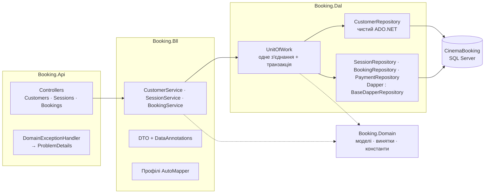

| Проєкт | Вміст |
|---|---|
| `Booking.Domain` | моделі таблиць (`Customer`, `Session`, `Booking`, `Ticket`, `BookingPayment`…), доменні винятки `NotFoundException` / `BusinessConflictException` / `ValidationException`, константи статусів |
| `Booking.Dal` | `IGenericRepository<T>` і конкретні інтерфейси; `CustomerRepository` (**чистий ADO.NET**, свідомо без Generic Repository); `SessionRepository`, `BookingRepository`, `PaymentRepository` (**Dapper**, спільний CRUD у `BaseDapperRepository<T>`); `UnitOfWork`; `SqlErrorTranslator` (SqlException → доменні винятки) |
| `Booking.Bll` | сервіси, DTO з валідацією, профілі AutoMapper |
| `Booking.Api` | тонкі контролери з атрибутною маршрутизацією, `DomainExceptionHandler`, Serilog, Swagger |
| `Booking.Tests` | unit-тести BLL (NSubstitute) + `AssertConfigurationIsValid` для AutoMapper |

Залежності в один бік: **Api → Bll → Dal**; `Domain` бачать і Dal, і Bll. Контролери не мають SQL і бізнес-правил. Увесь SQL лежить лише в `Booking.Dal`, усі значення передаються параметрами.

### Ендпоінти

| Метод | Шлях | Що робить | Статуси |
|---|---|---|---|
| GET | `/api/customers?search=&page=&pageSize=` | пошук глядачів з пагінацією | 200 |
| GET | `/api/customers/{id}` | глядач | 200, 404 |
| POST | `/api/customers` | створити | 201 + Location, 400, 409 (дубль email) |
| PUT | `/api/customers/{id}` | оновити (потрібен `rowVersion` з GET) | 200, 400, 404, 409 (конфлікт версій) |
| DELETE | `/api/customers/{id}` | м'яке видалення | 204, 404, 409 (є активні бронювання) |
| GET | `/api/customers/{id}/bookings` | бронювання глядача | 200, 404 |
| GET | `/api/sessions?movieId=` | майбутні сеанси | 200 |
| GET | `/api/sessions/{id}` · `/api/sessions/{id}/seats` | сеанс · схема залу | 200, 404 |
| POST · PUT · DELETE | `/api/sessions` · `/api/sessions/{id}` | CRUD розкладу | 201/200/204, 400, 404, 409 |
| GET | `/api/bookings/{id}` | бронювання з квитками й оплатою | 200, 404 |
| POST | `/api/bookings` | **забронювати** (транзакція) | 201 + Location, 400, 404, 409 (місце зайняте, сеанс почався) |
| POST | `/api/bookings/{id}/pay` | **оплатити** (транзакція, 2 репозиторії, ідемпотентно) | 200, 400, 404, 409 |
| POST | `/api/bookings/{id}/cancel` | скасувати (процедура `usp_Booking_ChangeStatus`) | 204, 404, 409 |
| POST | `/api/bookings/{id}/check-in` | вхід у зал, Paid → Used (та сама процедура) | 204, 404, 409 |

### Транзакції, ізоляція, конкурентність

| Операція | Що змінюється в одній транзакції UoW | Захист від гонок |
|---|---|---|
| `BookingService.CreateAsync` | `Bookings` (знімок `MovieTitle`, `SessionStartsAt`, `TotalAmount`) + `Tickets` (знімок `Price`, VIP × 1.5) | `UPDLOCK, HOLDLOCK` на перевірці зайнятих місць + фільтрований UNIQUE `(SessionId, SeatId) WHERE IsCancelled = 0` |
| `BookingService.PayAsync` | репозиторій 1: `Bookings` (Created → Paid); репозиторій 2: `BookingPayments` | `UPDLOCK` на рядку бронювання (**песимістично**); `TransactionId` — ключ **ідемпотентності** (UNIQUE) |
| `CustomerService.UpdateAsync` | `Customers` | **оптимістично**: `WHERE RowVersion = @RowVersion` → 409 |

* **Рівень ізоляції — `ReadCommitted`.** Вищі рівні (`RepeatableRead`, `Serializable`) прибирають більше аномалій читання, але тримають ширші блокування, і під навантаженням зростає ризик взаємних блокувань (deadlock) та очікувань. Тому послаблений рівень поєднується з **точковими** блокуваннями лише там, де потрібна гарантія: місця сеансу, рядок бронювання при оплаті. Додатково страхують UNIQUE-індекси БД.
* **Таймаути:** `CommandTimeout = 30 с` для кожної команди (`RepositoryBase`) і `Command Timeout=30` у рядку підключення. Довге блокування краще обірвати помилкою, ніж тримати з'єднання з пулу.
* **Відкат:** будь-який виняток усередині операції викликає `RollbackAsync`. Якщо запит обірвано, `DisposeAsync` UoW закриває незафіксовану транзакцію.
* **Optimistic vs pessimistic.** Оплата одного бронювання двома запитами одночасно — реальний сценарій (подвійне натискання, повтор callback-у), тому тут блокування рядка. Редагування профілю глядача — рідкісний конфлікт, і для нього достатньо RowVersion.

### Ланцюжок помилок: процедура → DAL → BLL → HTTP

| Джерело | DAL (`SqlErrorTranslator`) | HTTP (`DomainExceptionHandler`) |
|---|---|---|
| `THROW 50001` у процедурі | `NotFoundException` | 404 |
| `THROW 50002…50007` (недопустимий перехід, сеанс почався, …) | `BusinessConflictException` | 409 |
| порушення UNIQUE (2601/2627), FK (547) | `BusinessConflictException` | 409 |
| бізнес-валідація в сервісі | `ValidationException` | 400 |
| DataAnnotations на DTO | — (відхиляється до сервісу) | 400 `ValidationProblemDetails` |
| будь-що інше | — | 500 без внутрішніх подробиць |

Усі помилки повертаються у форматі **ProblemDetails** (RFC 9457) з `traceId`. Serilog пише один рядок логу на запит із `RequestId`, без секретів.

### Приклади запитів

У PowerShell використовуйте `curl.exe` (не аліас `curl`). Тіло з кирилицею надсилайте через Swagger / Postman або з файлу в UTF-8.

Створити глядача (201 + `Location`; апостроф безпечний, бо значення передаються лише параметрами):

```bash
curl -i -X POST http://localhost:5093/api/customers -H "Content-Type: application/json" -d "{\"fullName\":\"Sean O'Brien\",\"email\":\"obrien@example.com\"}"
```

Забронювати два місця на сеанс 2 (201):

```bash
curl -i -X POST http://localhost:5093/api/bookings -H "Content-Type: application/json" -d "{\"customerId\":2,\"sessionId\":2,\"seatIds\":[25,26]}"
```

**Відкат транзакції.** Оплата нового бронювання з `TransactionId`, що вже належить бронюванню №1, дає 409. Статус лишається `Created`, оплата не створюється:

```bash
curl -i -X POST http://localhost:5093/api/bookings/5/pay -H "Content-Type: application/json" -d "{\"amount\":360,\"method\":\"card\",\"transactionId\":\"SEED-TXN-0001\"}"
```

```bash
curl http://localhost:5093/api/bookings/5
```

Коректна оплата (200; повтор із тим самим `transactionId` не оплачує вдруге):

```bash
curl -X POST http://localhost:5093/api/bookings/5/pay -H "Content-Type: application/json" -d "{\"amount\":360,\"method\":\"card\",\"transactionId\":\"TXN-0005\"}"
```

Вхід у зал: перший раз 204, повторно **409** ProblemDetails (`Used -> Used`):

```bash
curl -i -X POST http://localhost:5093/api/bookings/5/check-in
```

Неіснуючий Id повертає **404**, а не 500:

```bash
curl -i http://localhost:5093/api/customers/999
```

### Тести

```bash
dotnet test --project Services/Booking/Booking.Tests
```

15 тестів:
- конфігурація AutoMapper;
- валідація DTO не залежить від культури ОС (uk-UA / en-US);
- «оплата неіснуючого → NotFound»;
- «помилка в другому репозиторії → Rollback без Commit»;
- ідемпотентність оплати;
- знімок назви й цін при бронюванні;
- зайняте місце / сеанс почався → Conflict;
- конфлікт RowVersion;
- видалення глядача з активними бронюваннями.

### Самоперевірка з умови

| Перевірка | Як | Результат |
|---|---|---|
| значення зі спецсимволом | POST глядача `Sean O'Brien` | 201, жодної SQL-помилки |
| помилка в другому репозиторії відкочує перший | оплата з чужим `TransactionId` | 409, статус лишився `Created` |
| повторний перехід статусу → 409 | `check-in` двічі | 409 ProblemDetails |
| неіснуючий Id → 404 | `GET /api/customers/999` | 404 ProblemDetails |
| AppHost: API і база Running | `dotnet run --project Platform.AppHost` | Dashboard |
| кожен ендпоінт у `/swagger` | Swagger UI | статуси з таблиці вище |

### Знімки екрана

Aspire Dashboard — `sql`, `BookingDb`, `booking-api` у статусі Running:

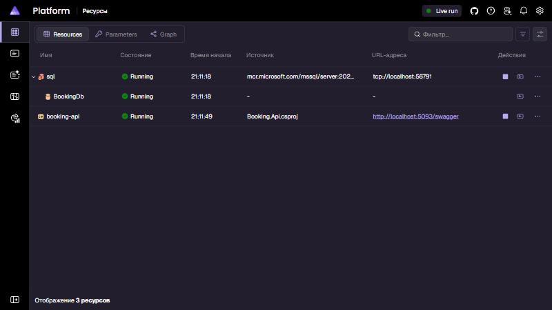

Swagger — перелік ендпоінтів:

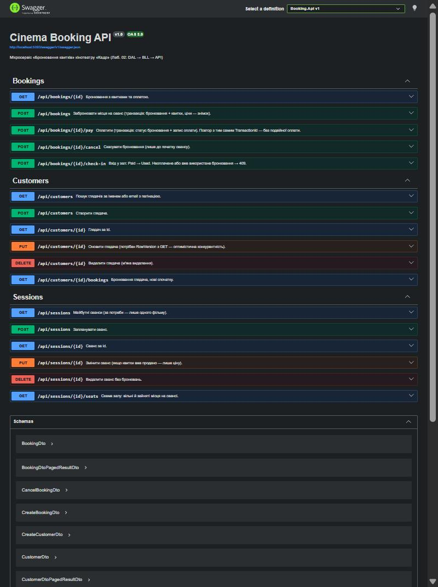

---

## Лаб. 03 — мікросервіс Catalog (EF Core, Code-First)

Мікросервіс «Каталог фільмів» (Проєкт №2 з Лаб. 01) із тією самою будовою, що й Booking, але доступ до даних — на **EF Core**:
- моделі й Fluent API, міграції, LINQ to Entities;
- Async Generic Repository + 3 специфічні репозиторії + Unit of Work;
- специфікації (Ardalis.Specification);
- DTO + AutoMapper, DataAnnotations + FluentValidation;
- ProblemDetails, Serilog.

### Що потрібно

**.NET SDK 10** і **Docker Desktop**. Інструмент `dotnet-ef` прописано в локальному маніфесті (`dotnet-tools.json`), достатньо виконати:

```bash
dotnet tool restore
```

### Запуск

**Через Aspire (рекомендовано)** — SQL Server, обидві БД, Booking.Api і Catalog.Api однією командою:

```bash
dotnet run --project Platform.AppHost
```

`catalog-api` на старті сам застосовує міграції (`MigrateAsync`) до порожньої БД `CinemaCatalog` і запускає ідемпотентний сідінг. Swagger: http://localhost:5024/swagger. Dashboard: http://localhost:15180.

**Окремо, проти SQL Server з docker compose:**

```bash
docker compose up -d --wait sqlserver
```

```bash
dotnet run --project Services/Catalog/Catalog.Api
```

Рядок підключення `CatalogDb` (`appsettings.json`) веде на окрему БД `CinemaCatalogEf`. Її створюють міграції, а `CinemaCatalog` з docker compose — це SQL-проєкт схеми з Лаб. 01. Перевизначення: `ConnectionStrings__CatalogDb`.

**Docker-образ:**

```bash
docker build -f Services/Catalog/Catalog.Api/Dockerfile -t cinema-catalog-api .
```

### Міграції

Міграції лежать у [`Services/Catalog/Catalog.Dal/Migrations`](Services/Catalog/Catalog.Dal/Migrations): `InitialCreate` + знімок моделі. SQL-скрипт — [`Migrations/Scripts/InitialCreate.sql`](Services/Catalog/Catalog.Dal/Migrations/Scripts/InitialCreate.sql). DbContext — у `Catalog.Dal`, рядок підключення — у `Catalog.Api`, тому вказуються обидва проєкти.

```bash
dotnet ef migrations add <НазваЗміни> --project Services/Catalog/Catalog.Dal --startup-project Services/Catalog/Catalog.Api -o Migrations
```

```bash
dotnet ef database update --project Services/Catalog/Catalog.Dal --startup-project Services/Catalog/Catalog.Api
```

```bash
dotnet ef migrations script --idempotent --project Services/Catalog/Catalog.Dal --startup-project Services/Catalog/Catalog.Api -o Services/Catalog/Catalog.Dal/Migrations/Scripts/InitialCreate.sql
```

### Будова

| Проєкт | Вміст |
|---|---|
| `Catalog.Domain` | сутності `Genre`, `Movie`, `MovieDetail` (1:1), `Person`, `MovieCredit` (M:N з полями `Role`, `CharacterName`, `BillingOrder`, `CreditedAt`). Приватні setter-и, валідація в конструкторах, зміни лише методами (`ChangeDuration`, `SetDetail`, `AddCredit`, `RemoveCredit`, `Archive`). Винятки `DomainException`, `EntityNotFoundException`, `ConflictException`, `ValidationException` |
| `Catalog.Dal` | `CatalogDbContext` (`ApplyConfigurationsFromAssembly`), `Configurations/` (окремий `IEntityTypeConfiguration<T>` на кожну сутність: таблиці, ключі, довжини, `decimal(18,2)`, UNIQUE, CHECK, зв'язки, `HasData` жанрів), `Migrations/`, `GenericRepository<T>`, 3 специфічні репозиторії, `UnitOfWork`, `Seeding/DbInitializer` |
| `Catalog.Bll` | сервіси (`MovieService`, `GenreService`, `PersonService`), DTO, `Specifications/` (`MoviesFilterSpec`, `PeopleFilterSpec`), `Validators/` (FluentValidation), профілі AutoMapper |
| `Catalog.Api` | тонкі контролери, явний виклик валідаторів, `ExceptionToProblemDetailsHandler`, `CorrelationIdMiddleware`, Serilog, Swagger, Dockerfile |
| `Catalog.Tests` | 24 тести: правила сутностей, специфікації в пам'яті, репозиторії на EF InMemory, сервіс, валідатори, AutoMapper |

### Репозиторії й Unit of Work

| Репозиторій | Спосіб завантаження | Специфічний запит |
|---|---|---|
| `GenericRepository<T>` | — | `GetByIdAsync`, `GetAllAsync`, `AddAsync` (async); `Update`, `Delete` (лише стан у контексті); `ListAsync(spec)`, `CountAsync(spec)` |
| `MovieRepository` | **Eager** — `Include(Genre).Include(Detail).Include(Credits).ThenInclude(Person)` | картка фільму **одним** SQL-запитом |
| `GenreRepository` | **Explicit** — `Entry(genre).Collection(g => g.Movies).Query()…LoadAsync()` | жанр, а потім його фільми **другим** запитом |
| `MovieCreditRepository` | **LINQ to Entities через проміжну сутність** | фільмографія (`MovieCredit → Movie → Genre` з полями зв'язку); головні ролі (фільтр за `Role`, `BillingOrder`) |

`UnitOfWork` об'єднує репозиторії над одним `DbContext` (Scoped). `SaveChangesAsync()` викликається **один раз** наприкінці бізнес-операції. Репозиторії самі нічого не зберігають. Помилки БД перетворюються на доменні: конфлікт RowVersion або UNIQUE → `ConflictException`.

Перевірено в лозі SQL ([`docs/screenshots/lab03-sql-eager-vs-explicit.log`](docs/screenshots/lab03-sql-eager-vs-explicit.log)): eager — **1** запит, explicit — **2**.

### Ендпоінти

| Метод | Шлях | Статуси |
|---|---|---|
| GET | `/api/movies?page=&pageSize=&search=&genreId=&yearFrom=&yearTo=&ageRating=&sortBy=title\|year\|duration&sortDir=asc\|desc` | 200, 400 |
| GET | `/api/movies/{id}` — картка (eager) | 200, 404 |
| POST | `/api/movies` | 201 + Location, 400, 409 (дубль «назва + рік») |
| PUT | `/api/movies/{id}` (з `rowVersion`) | 200, 400, 404, 409 |
| PUT | `/api/movies/{id}/detail` (1:1) | 200, 400, 404 |
| POST | `/api/movies/{id}/credits` (M:N) | 200, 400, 404, 409 (правила титрів) |
| DELETE | `/api/movies/{id}/credits/{personId}/{role}` | 204, 404, 409 |
| DELETE | `/api/movies/{id}` — в архів | 204, 404 |
| GET | `/api/genres` · `/api/genres/{id}` (explicit) | 200, 404 |
| POST · DELETE | `/api/genres` · `/api/genres/{id}` | 201 / 204, 400, 404, 409 |
| GET | `/api/people?page=&pageSize=&search=&bornFrom=&bornTo=&sortBy=name\|birthYear&sortDir=` | 200, 400 |
| GET · POST | `/api/people/{id}` · `/api/people` | 200 / 201, 400, 404 |
| GET | `/api/people/{id}/filmography` (M:N LINQ) | 200, 404 |
| GET | `/api/people/leads?genre=&maxBillingOrder=` (M:N LINQ) | 200, 400 |

### Пагінація, фільтрація, сортування

- **Запит:** `page` (з 1), `pageSize` (10 за замовчуванням, максимум 50), фільтри, `sortBy` / `sortDir`. Сортувати можна лише за полями з білого списку, інше — 400.
- **Відповідь:** `items`, `totalCount`, `page`, `pageSize`, `totalPages`, `hasNext`, `hasPrevious`. Ці ж метадані дублюються в заголовках `X-Pagination-TotalCount`, `X-Pagination-TotalPages`, `X-Pagination-Page`, `X-Pagination-PageSize`.
- **Реалізація:** `MoviesFilterSpec` / `PeopleFilterSpec` описують `Where`, `Include`, `OrderBy`, `Skip` / `Take`. Репозиторій застосовує їх через `WithSpecification()` — це один SQL `… ORDER BY … OFFSET … FETCH`. `CountAsync(spec)` рахує `COUNT(*)` за тими самими критеріями без пагінації. Обидві специфікації працюють через той самий `GenericRepository` без змін у ньому.

### Валідація та помилки

| Рівень | Що перевіряє | Відповідь |
|---|---|---|
| DataAnnotations на DTO | `Required`, `StringLength`, `Range` | 400 `ValidationProblemDetails` (автоматично) |
| FluentValidation (`Catalog.Bll/Validators`, явний виклик у контролерах) | рік випуску, тривалість, віковий рейтинг, формат RowVersion і URL, правила ролей у титрах, білий список сортування, `yearFrom ≤ yearTo` | 400 `ValidationProblemDetails` |
| Сервіси (BLL) | існування жанру / людини, унікальність «назва + рік», жанр без фільмів | 400 / 409 |
| Сутності (Domain) | інваріанти моделі | 409 `DomainException` |

`ExceptionToProblemDetailsHandler`:
- `EntityNotFoundException` → **404**;
- `ValidationException` → **400**;
- `ConflictException` / `DomainException` → **409**;
- решта → **500**, і подробиці віддаються лише в Development.

Кожен виняток логується один раз.

### Логування (Serilog)

Налаштування — розділ `Serilog` в [`appsettings.json`](Services/Catalog/Catalog.Api/appsettings.json):
- **sinks:** Console і File (`logs/catalog-*.json`, compact JSON, ротація щодня);
- **рівні:** Information за замовчуванням; `Microsoft.EntityFrameworkCore.Database.Command` = Information, тож у лог потрапляють SQL-запити EF Core;
- **властивості:** `CorrelationIdMiddleware` додає `CorrelationId` (заголовок `X-Correlation-Id` або згенерований, повертається у відповіді), `RequestPath`, `UserId`; `UseSerilogRequestLogging` пише один рядок на запит.

Рівні змінюються змінними оточення, наприклад `Serilog__MinimumLevel__Default=Warning`.

### Тести

```bash
dotnet test --project Services/Catalog/Catalog.Tests
```

### Самоперевірка з умови

| Перевірка | Результат |
|---|---|
| eager-репозиторій виконує 1 запит, explicit — 2 | ✅ [`lab03-sql-eager-vs-explicit.log`](docs/screenshots/lab03-sql-eager-vs-explicit.log) |
| POST з порожнім Title → 400 з помилками по полях | ✅ знімок нижче |
| повторне створення з тим самим «назва + рік» → 409; неіснуючий Id → 404 ProblemDetails | ✅ |
| `page=2&pageSize=2` → `totalCount` = усі записи (6), а не розмір сторінки | ✅ знімок нижче |
| повторний запуск не дублює seed-дані | ✅ у лозі «Seeding: дані каталогу вже є — пропущено», кількості 6 / 8 незмінні |
| друга специфікація (`PeopleFilterSpec`) працює через той самий репозиторій | ✅ `/api/people?...` |

### Знімки екрана (Лаб. 03)

Aspire Dashboard — `catalog-api` і `CatalogDb` у статусі Running:

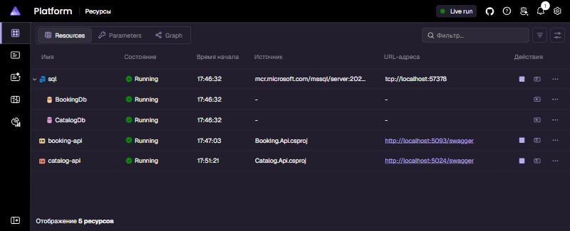

Swagger Catalog API:

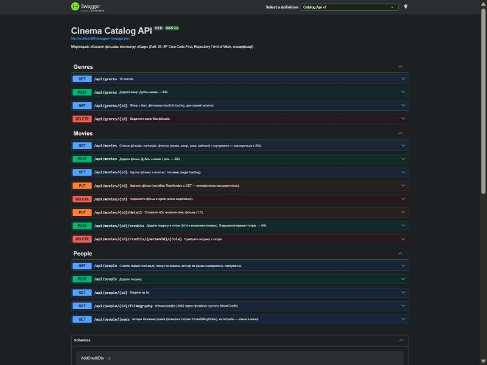

Відповідь з пагінацією (`page=2&pageSize=2`):

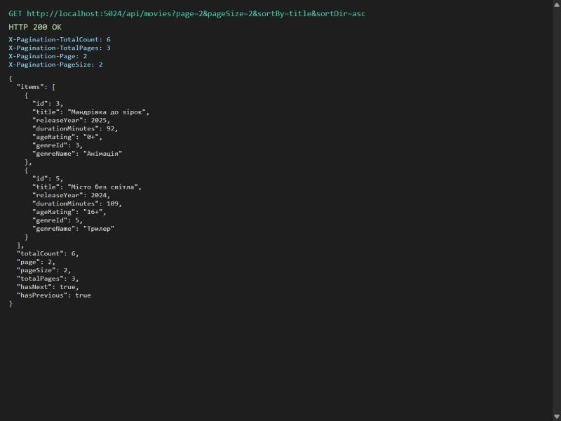

400 з помилками валідації (DataAnnotations і FluentValidation):

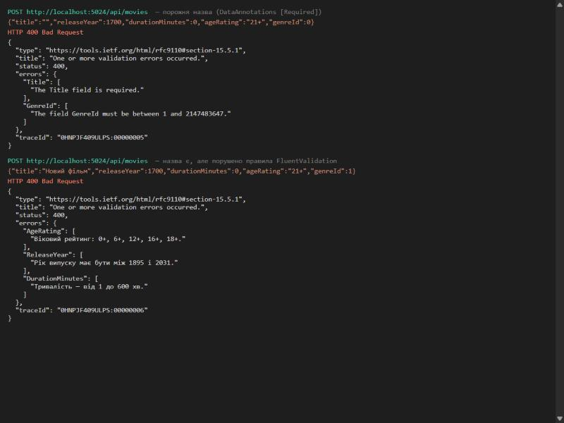

## Лаб. 04 — мікросервіс Reviews (Clean Architecture, CQRS + MediatR, MongoDB)

Мікросервіс «Відгуки та обговорення» (Проєкт №3 з Лаб. 01, база `cinema_reviews`). На відміну від тришарової вертикалі Лаб. 02–03, тут доменний шар нічого не знає ні про API, ні про базу даних.

### Схема шарів

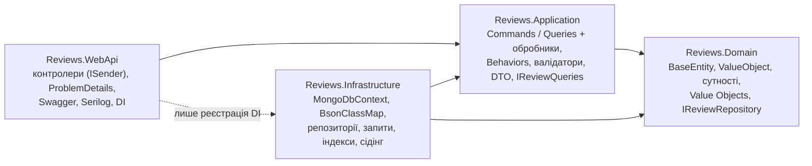

**Правило залежностей:** стрілки ведуть лише всередину. `Reviews.Domain` не посилається на жоден проєкт, з пакетів має лише `MongoDB.Bson` (тип `ObjectId`), драйвера `MongoDB.Driver` у ньому немає. Infrastructure реалізує інтерфейси, оголошені всередині: `IReviewRepository` / `IDiscussionRepository` / `IMessageRepository` у Domain, `IReviewQueries` / `IDiscussionQueries` в Application.

| Проєкт | Вміст |
|---|---|
| `Reviews.Domain` | `Common/BaseEntity` (`Id: ObjectId`, `CreatedAt`, `UpdatedAt`, `Version`), `Common/ValueObject` (`GetEqualityComponents`). Сутності `Review` (вкладений масив `comments[]`, гнучка схема за `kind`: quick / full / critic), `Comment`, `Discussion` (вкладені `lastMessages[]` ≤ 3), `Message`. Value Objects `Author`, `Rating`, `DiscussionStats`, `MessagePreview`. `DomainException`, `NotFoundException`, `ConflictException`. Інтерфейси репозиторіїв |
| `Reviews.Application` | `Common/Messaging` (`ICommand`, `ICommand<T>`, `IQuery<T>`), `Common/Behaviors` (Logging → Validation → Performance), `Common/Interfaces` (`IReviewQueries`, `IDiscussionQueries`), `Common/Models` (DTO, `PagedResult<T>`, `CursorPage<T>`), профілі AutoMapper. Фічі: `Reviews/Commands` (Create / Update / Delete / AddComment), `Reviews/Queries` (GetById / GetList), `Movies/Queries/GetMovieRating`, `Discussions/Commands` (CreateDiscussion / PostMessage), `Discussions/Queries`. `DependencyInjection.AddApplication()` |
| `Reviews.Infrastructure` | `Persistence/`: `MongoDbOptions`, `MongoDbContext`, `MongoMappings` (BsonClassMap + конвенції), `Serializers/` (`RatingSerializer`, `LowercaseEnumSerializer`), `Repositories/`, `Queries/`. `Seeding/`: `IDataSeeder` + сідери, `IndexCreationService`. `DependencyInjection.AddInfrastructure()` |
| `Reviews.WebApi` | `ReviewsController`, `DiscussionsController`, `MoviesController` (лише `ISender` + AutoMapper для тіл запитів), `ExceptionToProblemDetailsHandler`, `CorrelationIdMiddleware`, `appsettings.{Environment}.json`, health check `/health` |
| `Reviews.Tests` | 29 тестів: правила домену без БД, реальний pipeline MediatR із підмінними репозиторіями, BSON-мапінг без сервера, AutoMapper |

### Запуск

**Через Aspire (рекомендовано).** Піднімає SQL Server, MongoDB і всі три API:

```bash
dotnet run --project Platform.AppHost
```

`reviews-api` отримує порожню БД `cinema_reviews` (рядок підключення `ConnectionStrings__ReviewsDb` від Aspire). На старті він сам створює індекси (`IndexCreationService`) і засіває колекції (`DataSeedingService`). Swagger: http://localhost:5136/swagger. Dashboard: http://localhost:15180.

**Окремо, проти MongoDB з docker compose:**

```bash
docker compose up -d mongo
```

```bash
dotnet run --project Services/Reviews/Reviews.WebApi
```

Налаштування — секція `MongoDb` в `appsettings.json`: `ConnectionString` (з `maxPoolSize`, `serverSelectionTimeoutMS`), `DatabaseName`, `CreateIndexesOnStartup`, `SeedOnStartup`. Окремі значення задано в `appsettings.Development.json`, `appsettings.Staging.json` і `appsettings.Production.json` (у Production сідінг вимкнено, рядок підключення — зі змінної `MongoDb__ConnectionString`). Ключ Lucky Penny для MediatR / AutoMapper — `LuckyPenny__LicenseKey`. Без ключа працює Community-режим: у лозі лише попередження.

### CQRS і pipeline MediatR

Кожна операція API — окрема команда чи запит з окремим обробником. Контролери викликають тільки `ISender`. Обробники команд працюють через інтерфейси репозиторіїв, обробники запитів — через `IReviewQueries` / `IDiscussionQueries`. Ні контролери, ні Application не звертаються до `IMongoCollection`.

| Операція | Тип | Повертає |
|---|---|---|
| `CreateReviewCommand` · `CreateDiscussionCommand` | команда | Id (рядок ObjectId) |
| `UpdateReviewCommand` (версія з `If-Match`) · `AddCommentCommand` · `PostMessageCommand` | команда | DTO |
| `DeleteReviewCommand` | команда | — |
| `GetReviewByIdQuery` · `GetReviewsListQuery` · `GetMovieRatingQuery` | запит | DTO / `PagedResult` |
| `GetDiscussionByIdQuery` · `GetDiscussionsListQuery` · `GetDiscussionMessagesQuery` | запит | DTO / `PagedResult` / `CursorPage` |

Порядок behaviors задано в `AddApplication()` через `AddOpenBehavior`:

1. **LoggingBehavior** — зовнішній. Структуровано логує запит, результат і час. Якщо запит відхилено валідацією, пише «обробник НЕ викликався».
2. **ValidationBehavior** — запускає всі валідатори FluentValidation (разом з асинхронними), збирає всі помилки й кидає `ValidationException` до виклику обробника.
3. **PerformanceBehavior** — найближчий до обробника. Міряє час обробника разом із запитами до MongoDB; понад 500 мс пише Warning.

MongoDB-специфічні правила валідаторів:
- кожен Id перевіряється як ObjectId (`MustBeObjectId`);
- **асинхронне правило із запитом до MongoDB:** глядач ще не залишав відгук на цей фільм (`IReviewRepository.ExistsAsync`);
- **ще одне асинхронне правило:** `replyTo` існує в цьому ж обговоренні.

### MongoDB: мапінг, репозиторії, індекси, сідінг

- **BsonClassMap** (`MongoMappings.Register()`, один раз на старті). Доменні класи не мають BSON-атрибутів. Мапінг налаштовує:
  - конвенції camelCase, `IgnoreExtraElements` (гнучка схема) й `IgnoreIfNull`;
  - приватні поля `_comments`, `_tags`, `_lastMessages` → `comments`, `tags`, `lastMessages`;
  - створення Value Objects через конструктор (`MapCreator`), тож некоректні дані з БД теж не пройдуть;
  - `Rating` ↔ число, `ReviewKind` ↔ `"full"`;
  - дати в UTC.

  Документи мають структуру з Лаб. 01, тому сід-дані — це ті самі файли [`docs/samples/*.json`](docs/samples), підключені як ресурси, без копій.
- **Оптимістична конкурентність.** `ReplaceOne` має фільтр `{ _id, version: очікувана }` і пише `version + 1`. `MatchedCount = 0` → `ConflictException` → 409. Документи зі скриптів Лаб. 01 без поля `version` вважаються версією 0. API віддає версію в `ETag`; `PUT` вимагає `If-Match` (без нього — 428).
- **Читання.** `$project` одразу у форму DTO: `author.displayName` → `authorName`, `$size` коментарів. Список відгуків — один aggregation pipeline `$match` (+ `$text`) → `$facet { items: $sort/$skip/$limit/$project, total: $count }`. Рейтинг фільму — `$match` → `$group`. Повідомлення теми — **курсорна пагінація** (`_id > after`, `limit + 1`).
- **Індекси** (`IndexCreationService`, імена збігаються з `db/p3/collections.js`, тому повторне створення нічого не дублює):
  - `ix_reviews_movie_recent` `{movieId, createdAt}`;
  - `ix_reviews_author` `{author.customerId, createdAt}`;
  - **unique** `ux_reviews_movie_author` `{movieId, author.customerId}`;
  - **text** `tx_reviews_text` `{title, text}`;
  - `ix_discussions_movie`;
  - `ix_messages_discussion`;
  - `ix_messages_discussion_cursor` `{discussionId, _id}`.
- **Сідінг.** `IDataSeeder` на кожну колекцію (`ReviewSeeder`, `DiscussionSeeder`, `MessageSeeder`): `InsertManyAsync`, лише якщо колекція порожня.
- **Health check.** `/health` перевіряє з'єднання з MongoDB (`AspNetCore.HealthChecks.MongoDb`).

### Ендпоінти

| Метод | Шлях | Статуси |
|---|---|---|
| GET | `/api/reviews?movieId=&authorId=&kind=&minRating=&search=&sortBy=newest\|oldest\|rating\|likes&page=&pageSize=` | 200, 400 |
| GET | `/api/reviews/{id}` (+ `ETag`) | 200, 400 (не ObjectId), 404 |
| POST | `/api/reviews` | 201 + `Location: /api/reviews/{ObjectId}`, 400, 409 (унікальний індекс) |
| PUT | `/api/reviews/{id}` + `If-Match: "N"` | 200, 400, 404, 409 (версія), 428 (без If-Match) |
| DELETE | `/api/reviews/{id}` (+ необов'язковий `If-Match`) | 204, 400, 404, 409 |
| POST | `/api/reviews/{id}/comments` | 201, 400 (напр. коментар до quick-відгуку), 404, 409 |
| GET | `/api/movies/{movieId}/rating` | 200, 404 |
| GET · POST | `/api/discussions?movieId=&page=&pageSize=` · `/api/discussions` | 200 / 201, 400 |
| GET | `/api/discussions/{id}` | 200, 400, 404 |
| GET · POST | `/api/discussions/{id}/messages?after=&limit=` (курсор) | 200 / 201, 400, 404 |

### Обробка помилок

`ExceptionToProblemDetailsHandler` (`IExceptionHandler` + `AddProblemDetails`) перетворює винятки на ProblemDetails. Кожен виняток логується один раз:

| Виняток | HTTP |
|---|---|
| `NotFoundException` | 404 |
| `ValidationException` (FluentValidation, з pipeline) | 400, помилки по полях |
| `DomainException` | 400 |
| `ConflictException` (конфлікт версій) | 409 |
| `MongoWriteException` / `MongoBulkWriteException` з `DuplicateKey` | 409 (з назвою індексу) |
| інші `MongoWriteException` | 400 |
| `MongoConnectionException`, таймаут вибору сервера | 503 + `Retry-After` |
| решта | 500 (деталі лише в Development) |

### Тести

```bash
dotnet test --project Services/Reviews/Reviews.Tests
```

### Самоперевірка з умови

| Перевірка | Результат |
|---|---|
| `Reviews.Domain` не має посилань на інші проєкти рішення | ✅ [`Reviews.Domain.csproj`](Services/Reviews/Reviews.Domain/Reviews.Domain.csproj): лише `MongoDB.Bson` |
| жоден контролер і обробник не звертається до `IMongoCollection` | ✅ `IMongoCollection` є лише в `Reviews.Infrastructure` |
| unit-тест: `Review` з Rating = 10 → `DomainException` без БД | ✅ `DomainTests` |
| команда з Rating = 10 → 400 до виклику обробника | ✅ [`lab04-validation-before-handler.log`](docs/screenshots/lab04-validation-before-handler.log): є «обробник НЕ викликався», рядка PerformanceBehavior немає |
| `db.reviews.find()` без приватних полів .NET; `getIndexes()` показує індекси | ✅ [`lab04-mongo-reviews.txt`](docs/screenshots/lab04-mongo-reviews.txt) |
| повторний відгук того самого глядача на той самий фільм відхиляється | ✅ 400 від асинхронного валідатора; при одночасних запитах — 409 «Дублікат» від унікального індексу (20 паралельних POST: 1 × 201, решта 400 / 409, жодного 500) |
| конфлікт версій | ✅ `PUT` зі старим `If-Match` → 409 |
| повторний запуск не дублює seed-дані | ✅ у лозі «Сідінг reviews: колекція вже містить дані — пропущено», кількості 6 / 2 / 4 незмінні |
| MongoDB вимкнена | ✅ 503 + `Retry-After`, `/health` → Unhealthy |

### Знімки екрана (Лаб. 04)

Aspire Dashboard — `mongo`, `ReviewsDb` і `reviews-api` у статусі Running:

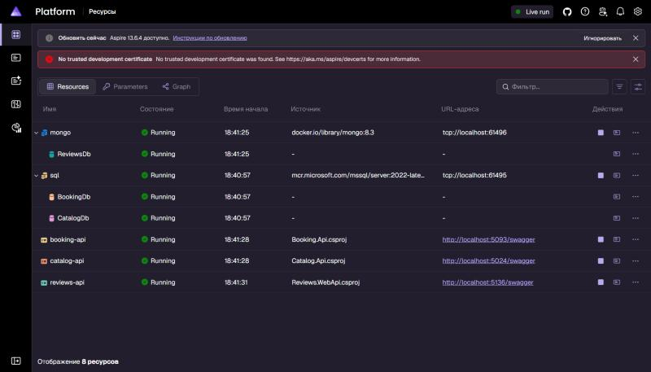

Swagger Reviews API:

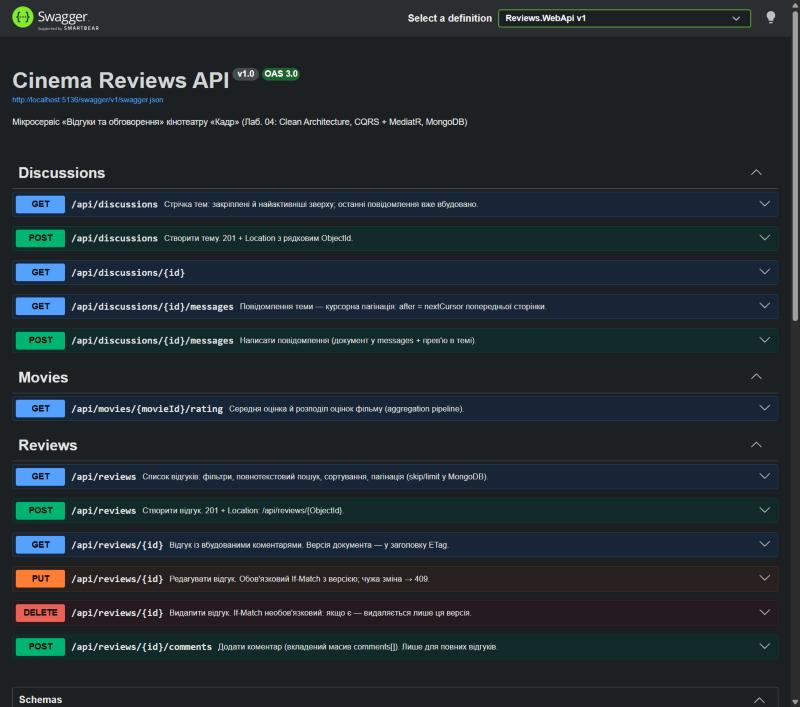

## Лаб. 05 — мікросервісна платформа на .NET Aspire (YARP Gateway, Aggregator, OpenTelemetry, Serilog)

Три мікросервіси з Лаб. 02–04 працюють як одна платформа. Її запускає одна команда; клієнт звертається лише до Gateway; сервіси знаходять один одного за логічними іменами; один запит видно в Dashboard і як trace, і за CorrelationId.

### Архітектура

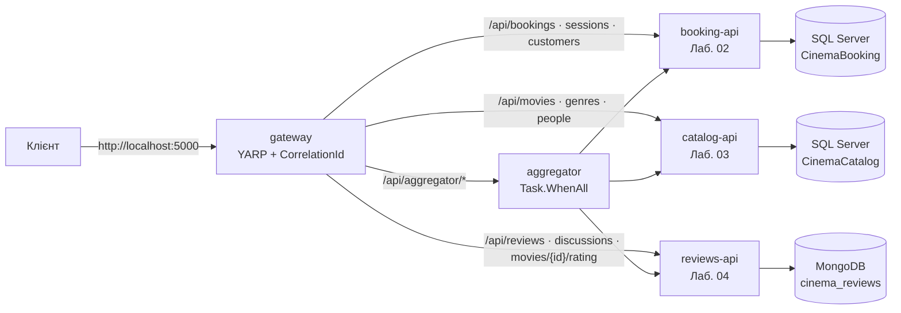

| Компонент | Що робить |
|---|---|
| `Platform.AppHost` | Оркестрація без бізнес-логіки. Контейнери SQL Server (пароль — параметр-секрет `sql-password`) і MongoDB з томами `cinema-sql-data` / `cinema-mongo-data`. Сервіси реєструються через `AddProject`, БД передаються через `WithReference`. Порядок запуску задано `WaitFor`: БД → сервіси → aggregator → gateway |
| `Platform.ServiceDefaults` | Підключається в кожен сервіс через `AddServiceDefaults()`: Serilog, OpenTelemetry (ASP.NET Core, HttpClient, SqlClient, MongoDB), `CorrelationIdMiddleware` і `CorrelationIdHandler`, health checks `/health` і `/alive`, service discovery, resilience для HttpClient |
| `Platform.ApiGateway` | YARP на порту **5000**. Маршрути й кластери описано в `appsettings.json`, адреси кластерів — логічні імена (`http://booking-api`). Логує рішення про маршрутизацію; рахує метрики `gateway.requests`, `gateway.request.duration`, `gateway.proxy.errors` |
| `Platform.Aggregator` | Typed HttpClients `BookingClient`, `CatalogClient`, `ReviewsClient` (адреса `https+http://` + ім'я ресурсу), паралельні виклики через `Task.WhenAll`, часткові відповіді з `warnings` |
| `Services/*` | Лаб. 02–04 без змін бізнес-логіки (див. «Інтеграція сервісів») |

### Запуск

Потрібні **Docker Desktop** (запущений) і **.NET SDK 10**. Пароль SQL Server один раз зберігається в секретах AppHost:

```bash
dotnet user-secrets set "Parameters:sql-password" "Cinema_Aspire_2026!" --project Platform.AppHost
```

Якщо секрет не задано, Dashboard запитає значення під час першого запуску. Потім уся платформа стартує однією командою:

```bash
dotnet run --project Platform.AppHost
```

- Dashboard: http://localhost:15180 (посилання з токеном — у консолі).
- Gateway: http://localhost:5000 (`GET /` показує таблицю маршрутів).
- Swagger сервісів і агрегатора — у колонці URL Dashboard.

Дані зберігаються в томах між перезапусками. Скрипти Лаб. 01 для `CinemaBooking` виконуються лише при першому створенні БД: якщо БД уже є, `SET NOEXEC ON` вимикає решту батчів. Щоб почати з чистої бази, видаліть томи:

```bash
docker volume rm cinema-sql-data cinema-mongo-data
```

Пароль `sa` зберігається в томі, тому `sql-password` має лишатися тим самим. Пароль MongoDB Aspire генерує й зберігає в user-secrets сам.

### Інтеграція сервісів (мінімальні зміни)

| Сервіс | Що змінено |
|---|---|
| Booking.Api, Catalog.Api, Reviews.WebApi | `Program.cs`: `builder.AddServiceDefaults()` замість власного `UseSerilog`; `app.UseMiddleware<CorrelationIdMiddleware>()` (зі ServiceDefaults); `app.MapDefaultEndpoints()` |
| те саме | `.csproj`: посилання на `Platform.ServiceDefaults` замість пакета `Serilog.AspNetCore`; `appsettings.json`: прибрано власні sinks Serilog (лишилося точкове перевизначення рівня SQL-логів EF Core у Catalog) |
| Catalog.Api, Reviews.WebApi | видалено власні `Logging/CorrelationIdMiddleware.cs` — їх замінила спільна версія з ServiceDefaults |
| Reviews.Infrastructure | один рядок — підписка драйвера на трасування: `settings.ClusterConfigurator = cb => cb.Subscribe(new DiagnosticsActivityEventSubscriber())` |
| Booking.Bll, Catalog.Bll, Reviews.Application | логування бізнес-подій і власні spans (див. нижче); правила й поведінка операцій не змінилися |

Правил і поведінки операцій (BLL, DAL, Domain, Application) не змінено — лише додано телеметрію. Рядки підключення сервіси читають як і раніше: `ConnectionStrings:BookingDb` / `CatalogDb` / `ReviewsDb`. Під Aspire їх передає `WithReference`, без Aspire використовуються резервні значення з `appsettings.json`.

### Gateway (YARP)

| Маршрут | Шлях | Кластер → ресурс | Order |
|---|---|---|---|
| `aggregator` | `/api/aggregator/{**catch-all}` | `aggregator` | 1 |
| `reviews-movie-rating` | `/api/movies/{movieId}/rating` | `reviews` → `reviews-api` | 2 |
| `booking-bookings` · `booking-sessions` · `booking-customers` | `/api/bookings/…` · `/api/sessions/…` · `/api/customers/…` | `booking` → `booking-api` | 10 |
| `catalog-genres` · `catalog-people` | `/api/genres/…` · `/api/people/…` | `catalog` → `catalog-api` | 10 |
| `reviews-reviews` · `reviews-discussions` | `/api/reviews/…` · `/api/discussions/…` | `reviews` → `reviews-api` | 10 |
| `catalog-movies` | `/api/movies/{**catch-all}` | `catalog` → `catalog-api` | 100 |

- **Пріоритет маршрутів.** `/api/movies/*` належить Каталогу, але `/api/movies/{id}/rating` — сервісу відгуків. Тому специфічніший маршрут має менший `Order`.
- **Додаткові налаштування.** Кластери мають `ActivityTimeout`, маршрути — `MaxRequestBodySize` (1 МБ) і `Metadata` (Team, Version). Каталог використовує `LoadBalancingPolicy: RoundRobin`.
- **Service discovery.** `AddServiceDiscoveryDestinationResolver()` замінює `http://booking-api` на реальну адресу від Aspire. Без Aspire адреси беруться з секції `Services` в `appsettings.json`.
- **CorrelationId.** `CorrelationIdMiddleware` стоїть перед `MapReverseProxy()`. Якщо клієнт надіслав `X-Correlation-Id`, той зберігається, інакше генерується GUID; факт генерації логується. YARP копіює заголовок у проксований запит.
- **Логування.** `GatewayLoggingMiddleware` пише один рядок на запит: маршрут, кластер, адреса, статус, тривалість, розмір відповіді. Помилки проксування (таймаут, відмова з'єднання) пишуться як Error з типом помилки. Приклад: [`docs/screenshots/lab05-gateway-routing.log`](docs/screenshots/lab05-gateway-routing.log).

### Aggregator

| Ендпоінт | Основні дані (послідовно) | Паралельно (`Task.WhenAll`) |
|---|---|---|
| `GET /api/aggregator/bookings/{id}/full` — картка бронювання | booking-api: бронювання → сеанс (з нього `movieId`) | catalog-api: фільм · reviews-api: рейтинг · reviews-api: останні відгуки |
| `GET /api/aggregator/movies/{id}/full` — картка фільму | catalog-api: фільм | booking-api: найближчі сеанси · reviews-api: рейтинг · reviews-api: останні відгуки |

- **Часткові відмови.** Кожен необов'язковий виклик обгорнутий у `CallTracker.TryAsync`. Він логує «Calling … → responded in N ms», а відмову перетворює на попередження в `warnings` (одне на сервіс). У `sources` видно статус і тривалість кожного виклику.
- **Коли картки немає.** Основний ресурс не знайдено → 404. Основний сервіс недоступний → 503 + `Retry-After`.
- **Узгодженість.** Агрегатор попереджає, якщо назва фільму в Бронюванні (копія довідника) відрізняється від Каталогу, і відкидає сеанси чи відгуки іншого фільму.
- **JSON.** camelCase, null-поля не серіалізуються. `CancellationToken` передається в усі вихідні виклики.
- **Таймаути.** Зупинений у Dashboard сервіс не відмовляє одразу, а «висить». Тому агрегатор звужує стандартні таймаути resilience через секцію `HttpResilience` в `appsettings.json`: спроба 2 с, загалом 5 с, 1 повтор. Тоді часткова відповідь приходить за ~5 с, а не впирається в 30-секундний таймаут Gateway (504).

### Бізнес-події та власні spans

Кожен бізнес-шар має власний `ActivitySource`, підключений до OpenTelemetry у ServiceDefaults: `Booking.Bll` ([`BookingTelemetry`](Services/Booking/Booking.Bll/Diagnostics/BookingTelemetry.cs)), `Catalog.Bll` ([`CatalogTelemetry`](Services/Catalog/Catalog.Bll/Diagnostics/CatalogTelemetry.cs)) і `Reviews.Application` ([`ReviewsTelemetry`](Services/Reviews/Reviews.Application/Common/Diagnostics/ReviewsTelemetry.cs)). Span операції обгортає її SQL- чи MongoDB-команди. Логи мають структуровані властивості; чутливих даних (TransactionId оплати, email, телефон) у них немає.

| Сервіс | Spans | Бізнес-події в логах (властивості) |
|---|---|---|
| booking-api | `booking.create`, `booking.pay`, `booking.cancel`, `booking.check-in` | бронювання створено / оплачено / скасовано / використано: `BookingId`, `CustomerId`, `SessionId`, `SeatsCount`, `Amount`, `PaymentMethod`, `Status` |
| catalog-api | `movie.create`, `movie.update`, `movie.set-detail`, `movie.add-credit`, `movie.remove-credit`, `movie.archive` | фільм створено / оновлено / в архіві, титри змінено: `MovieId`, `Title`, `ReleaseYear`, `GenreId`, `AgeRating`, `PersonId`, `Role`, `Status` |
| reviews-api | `review.create`, `review.update`, `review.delete`, `review.add-comment`, `discussion.create`, `discussion.post-message` | відгук створено / оновлено / видалено, коментар, тема, повідомлення: `ReviewId`, `MovieId`, `Kind`, `Rating`, `CustomerId`, `Version`, `DiscussionId`, `MessageId` |
| aggregator | `AggregateBookingCard`, `AggregateMovieCard` | «Calling … / responded in N ms» для кожного виклику сервісу |

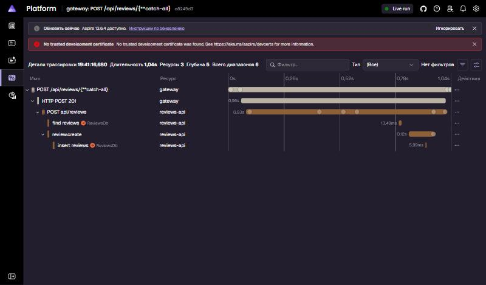

### Спостережуваність

- **Serilog.** Кожен запис — JSON (`CompactJsonFormatter`) у консолі й `logs/<сервіс>-*.json`. `writeToProviders: true` передає записи провайдеру OpenTelemetry → вкладка **Structured logs**.
  - Властивості: `ServiceName`, `EnvironmentName`, `MachineName`, `ThreadId`, `CorrelationId`, `TraceId`, `SpanId`.
  - Рівні: Debug у Development, Information в інших середовищах. Логи EF Core, HttpClient і Microsoft.* — від Warning.
- **OpenTelemetry.** Spans вхідних запитів (ASP.NET Core), вихідних викликів (HttpClient), SQL (SqlClient — і Dapper, і EF Core) та MongoDB, а також власні spans `AggregateBookingCard` / `AggregateMovieCard`. Метрики: ASP.NET Core, HttpClient, runtime, Gateway.
  - Експорт — OTLP в Aspire Dashboard.
  - Sampling: 100 % у Development, `OpenTelemetry:SamplingRatio` (10 %) в інших середовищах.
- **CorrelationId чи TraceId.** `CorrelationId` створює й передає сам застосунок: заголовок `X-Correlation-Id` у Gateway → YARP → сервіси, а з агрегатора — через `CorrelationIdHandler` у HttpClient. Повертається клієнту в заголовку відповіді. `TraceId` генерує OpenTelemetry для технічного трасування.

### Перевірка (curl)

```bash
curl -i http://localhost:5000/api/bookings/1
```

```bash
curl -i "http://localhost:5000/api/movies?page=1&pageSize=2"
```

```bash
curl -i -H "X-Correlation-Id: demo-001" http://localhost:5000/api/aggregator/bookings/1/full
```

### Самоперевірка з умови

| Перевірка | Результат |
|---|---|
| AppHost запускає все однією командою, у Dashboard 10 ресурсів Running | ✅ знімок нижче |
| `/health` кожного сервісу | ✅ booking, catalog, reviews, aggregator, gateway → Healthy |
| запити через Gateway до всіх сервісів, у відповіді `X-Correlation-Id` | ✅ 12 маршрутів → 200; невідомий шлях → 404 |
| пошук у Dashboard за одним CorrelationId знаходить логи всіх сервісів ланцюжка | ✅ gateway, aggregator, booking-api, catalog-api, reviews-api — знімок нижче |
| trace агрегувального запиту: Gateway → Aggregator → сервіси → БД, SQL- і MongoDB-spans, catalog-api та reviews-api паралельно | ✅ знімок нижче |
| зупинка reviews-api → часткова відповідь з попередженням, а не 500 | ✅ 200 за ~5 с, `warnings: ["reviews-api is unavailable — …"]` ([`lab05-partial-response.json`](docs/screenshots/lab05-partial-response.json)); після запуску сервісу відповідь знову повна |
| у сервісах Лаб. 02–04 змінено лише Program.cs (+ посилання на ServiceDefaults, конфіг Serilog) і додано телеметрію бізнес-операцій | ✅ таблиця «Інтеграція сервісів» |
| логування бізнес-подій і власні spans | ✅ `review.create` → `insert reviews` (MongoDB), `movie.update` → SELECT/UPDATE (SQL) у trace; логи «Створено відгук {ReviewId}…», «Оновлено фільм {MovieId}…» |
| прямий виклик сервісу в обхід Gateway | ✅ сервіс сам генерує CorrelationId; через Gateway зберігається ідентифікатор клієнта й додається лог маршрутизації |
| дані переживають перезапуск AppHost (томи) | ✅ `createdAt` клієнта той самий після рестарту, фільмів у Каталозі так само 6 |

Тести агрегатора (8): паралельність, часткова відмова, 404/503, узгодженість, передача CorrelationId:

```bash
dotnet test --project Platform.Aggregator.Tests
```

### Знімки екрана (Лаб. 05)

Ресурси в статусі Running:

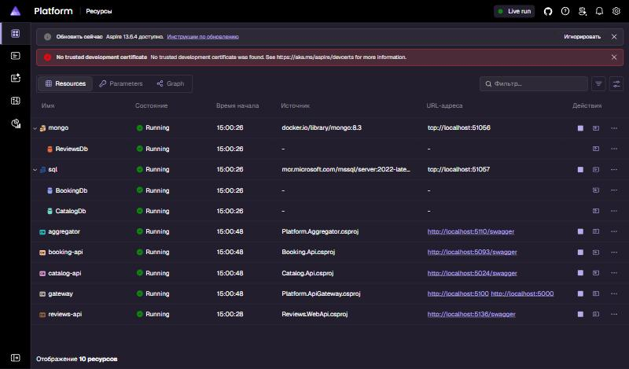

Trace агрегувального запиту — Gateway → Aggregator → booking-api (SQL) → паралельно catalog-api (SQL) і reviews-api (MongoDB):

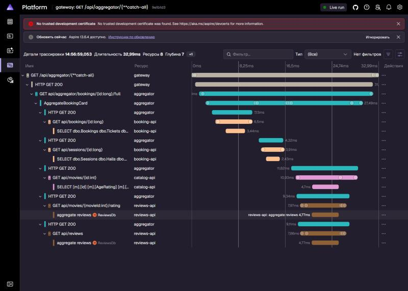

Structured logs, відфільтровані за `CorrelationId = lab05-demo-0001`:

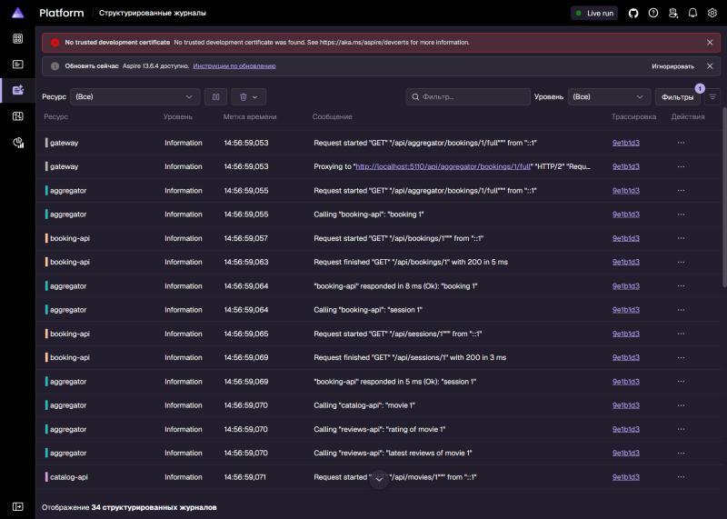

Властивості запису (ServiceName, EnvironmentName, MachineName, ThreadId, CorrelationId; TraceId і SpanId — у блоці «Контекст»):

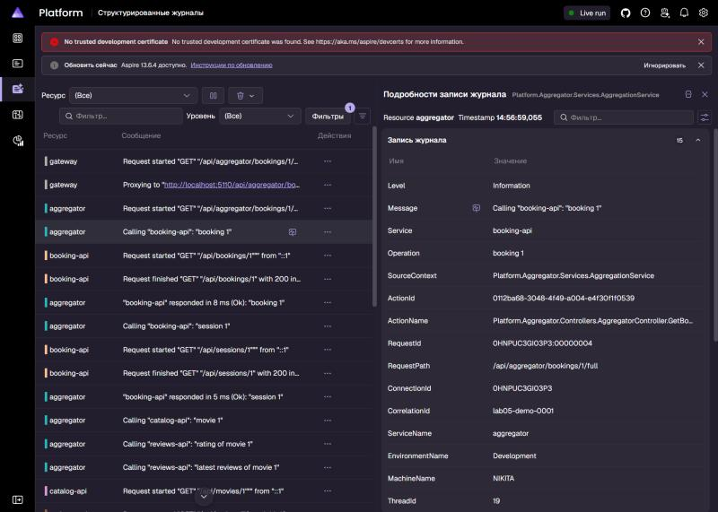

Зупинений reviews-api: spans з помилками, а Gateway повертає 200 з частковою відповіддю:

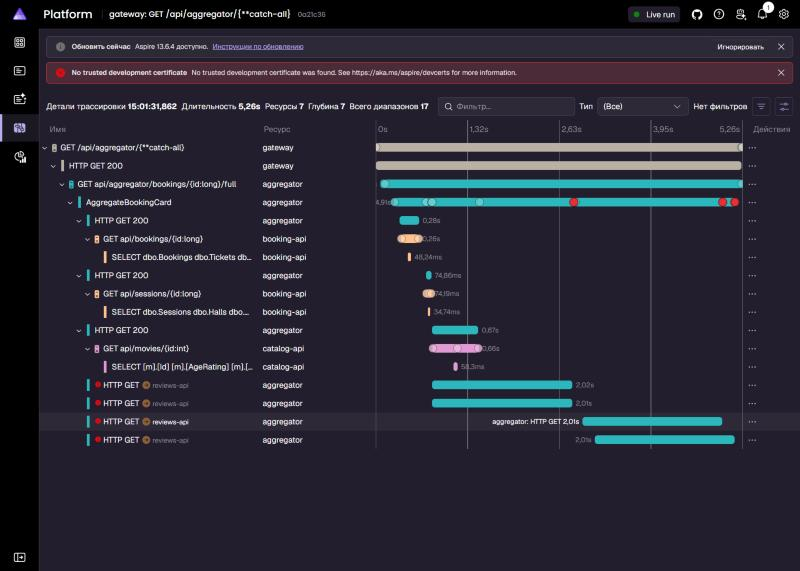

## Лаб. 06 — gRPC між сервісами та дворівневе кешування (Memory + Redis)

Платформа з Лаб. 05 отримала:
- кеш L1 (пам'ять) → L2 (Redis) → БД у сервісах, дані яких часто читають і рідко змінюють (Каталог, Відгуки);
- gRPC-контракти в усіх трьох сервісах;
- Aggregator, що звертається до сервісів по gRPC і кешує готові відповіді в Redis.

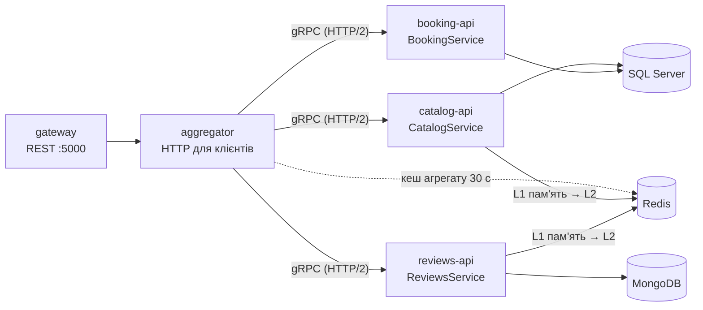

### Інфраструктура

- **AppHost.**
  - Redis: `builder.AddRedis("redis").WithDataVolume("cinema-redis-data")`.
  - catalog-api, reviews-api й aggregator отримують `.WithReference(redis).WaitFor(redis)` і рядок підключення `ConnectionStrings:redis`.
- **HTTP/2 для gRPC без TLS.** Кожен сервіс має в `appsettings.json` два endpoint-и Kestrel:
  - `http` — HTTP/1.1, REST через Gateway;
  - `grpc` — `"Protocols": "Http2"`, h2c для внутрішніх викликів.

  Aspire бере їх з конфігурації сервісу й лише підставляє адреси. Окремий endpoint потрібен, бо на звичайному HTTP Kestrel не узгоджує HTTP/2 через ALPN: на спільному endpoint виклик падав з `HTTP_1_1_REQUIRED`.
- **Контракти.** `Services/*/…Api/Protos/*.proto` підключено в сервісах як `<Protobuf … GrpcServices="Server" />`, а в `Platform.Aggregator` — ті самі файли (через `Link`) як `GrpcServices="Client"`.

### Кешування (L1 → L2 → БД)

| | Каталог ([`Catalog.Bll/Caching`](Services/Catalog/Catalog.Bll/Caching)) | Відгуки ([`Reviews.Application/Common/Caching`](Services/Reviews/Reviews.Application/Common/Caching)) |
|---|---|---|
| Що кешується | картка фільму `catalog:movie:{id}`, жанри `catalog:genres:all`, сторінки списку `catalog:movies:list:{версія}:…` | рейтинг фільму `reviews:rating:{movieId}`, відгук `reviews:review:{id}`, сторінки списку `reviews:list:…:v{версія}` |
| Як | `ITwoLevelCache.GetOrCreateAsync` у `MovieService` / `GenreService` (cache-aside) | `CachingBehavior` у pipeline MediatR для запитів з `ICacheableQuery` (Logging → Validation → **Caching** → Performance) |
| Інвалідація | після кожного запису: `RemoveAsync(catalog:movie:{id})` + нова версія списків (`BumpVersionAsync`); жанри — при створенні й видаленні | у командах Create / Update / Delete / AddComment: відгук, рейтинг фільму, версія списків |

- **L1 — `IMemoryCache`:**
  - `SizeLimit` = 20 000 одиниць (одиниця — КБ серіалізованого значення);
  - `CompactionPercentage` 25 %;
  - у кожного запису є `Size`, `SlidingExpiration` (для часто запитуваних), `AbsoluteExpiration` і `Priority`.
- **L2 — `IDistributedCache` поверх Redis** через `builder.AddRedisDistributedCache("redis")`, значення серіалізуються в JSON (System.Text.Json). TTL залежить від типу даних ([`CachePolicy`](Services/Catalog/Catalog.Bll/Caching/CachePolicy.cs)):
  - картка фільму: L1 2/5 хв, L2 30 хв;
  - жанри: L1 10 хв, L2 6 год;
  - списки: L1 1/2 хв, L2 10 хв.

  L1 завжди коротший за L2 (є тест).
- **Шлях читання.** L1 → L2 → БД. Рівні заповнюються на зворотному шляху: значення з Redis кладеться в L1, з БД — в обидва рівні. «Немає даних» не кешується.
- **Без Redis сервіс працює.** Помилка L2 → попередження в лозі, метрика `cache.errors`, і на 30 с L2 пропускається. Таймаути Redis — 1 с. Сервіс відповідає з L1 / БД, а `/health` повертає `Degraded` замість `Unhealthy`, бо health check Redis від Aspire вимкнено: кеш — не критична залежність.
- **Логи** зі структурованими властивостями: `Cache hit {CacheKey} at {CacheLevel}`, `Cache miss {CacheKey}`, `Cache filled {CacheKey}: {SizeBytes} bytes, L1 TTL…, L2 TTL…`, `Cache invalidated {CacheKey}, reason {Reason}`.
- **Метрики** (Meter `Catalog.Cache` / `Reviews.Cache` / `Platform.Aggregator.Cache`, підключено в ServiceDefaults):
  - `cache.hits` / `cache.misses` з тегом `cache.level` (L1 | L2);
  - `cache.invalidations` з причиною;
  - `cache.errors`;
  - `cache.operation.duration`.

  Знімок hit ratio — у `/health` (перевірка `cache`).

### gRPC-сервіси

| Сервіс | Контракт | RPC |
|---|---|---|
| booking-api | [`booking.proto`](Services/Booking/Booking.Api/Protos/booking.proto) (`package booking`, `google.protobuf.Timestamp`, гроші — `DecimalValue {units, nanos}`) | `GetBooking`, `GetSession`, `GetUpcomingSessions` |
| catalog-api | [`catalog.proto`](Services/Catalog/Catalog.Api/Protos/catalog.proto) (`optional` для необов'язкових рядків) | `GetMovie`, `GetMoviesByIds`, `ListGenres` |
| reviews-api | [`reviews.proto`](Services/Reviews/Reviews.WebApi/Protos/reviews.proto) (`map<int32,int32>` для розподілу оцінок) | `GetMovieRating`, `GetLatestReviews`, `GetReview` |

- **Реалізації** (`…Api/Grpc/*GrpcService.cs`) — адаптери над тим самим BLL / MediatR, що й REST-контролери. Тому кеш працює для обох протоколів без дублювання коду.
- **Помилки:**
  - вхідні дані перевіряються, некоректні → `InvalidArgument`;
  - доменні винятки → `RpcException` з точним кодом: NotFound → `NotFound`, валідація → `InvalidArgument`, конфлікт → `FailedPrecondition`;
  - `Internal` не повертається.
- **Реєстрація.** `services.AddDefaultGrpc()` з ServiceDefaults: `AddGrpc` + `GrpcLoggingInterceptor` (серверний interceptor: метод, peer, статус і тривалість — структурованими властивостями; помилки — зі статусом). Плюс `app.MapGrpcService<…>()`.

### Aggregator на gRPC

- **Клієнти.**
  - `AddGrpcClient<…Client>(o => o.Address = new("http://_grpc.catalog-api"))` для кожного сервісу. `_grpc.` вибирає іменований endpoint ресурсу, решту адреси підставляє service discovery.
  - Клієнти будуються на `IHttpClientFactory`, тож ServiceDefaults працюють і тут: resilience, а `CorrelationIdHandler` кладе `X-Correlation-Id` у метадані кожного gRPC-виклику, без окремого коду.
- **[`GrpcPlatformSources`](Platform.Aggregator/Clients/GrpcPlatformSources.cs)** перетворює protobuf-повідомлення на контракти агрегатора. Кожен виклик має `CancellationToken` і deadline 3 с; `NOT_FOUND` → `null`.
- **Агрегація** та сама, що в Лаб. 05: основний ресурс → незалежні виклики паралельно через `Task.WhenAll`.
  - `CallTracker` перехоплює `RpcException` (`Unavailable`, `DeadlineExceeded` тощо) і перетворює на попередження в `warnings`, без 500.
  - HTTP-джерела з Лаб. 05 лишено (`?transport=http`) лише для вимірювання.
- **Кеш агрегату в Redis** ([`AggregatedResponseCache`](Platform.Aggregator/Caching/AggregatedResponseCache.cs)):
  - ключ з параметрів запиту (`aggregator:booking:{id}:full`), перевіряється ДО gRPC-викликів;
  - TTL 30 с — коротший за кеші сервісів, щоб агрегат не був «свіжішим» за власні дані;
  - часткові відповіді (є `warnings`) не кешуються;
  - заголовок `X-Aggregator-Cache: HIT | MISS | BYPASS` (`?useCache=false` — для вимірювань).
- **Трасування.** `AddSource("Grpc.Net.Client")` у ServiceDefaults. Без нього клієнтський span gRPC випадав з ієрархії, і HTTP/2-запити показувалися на верхньому рівні trace.

### Порівняння HTTP (Лаб. 05) і gRPC (Лаб. 06)

[`docs/screenshots/lab06-latency-http-vs-grpc.txt`](docs/screenshots/lab06-latency-http-vs-grpc.txt): 2 × 50 запитів через Gateway на кожен транспорт після прогріву, без кешу агрегату, локальний Aspire.

| Запит | HTTP медіана / p95 | gRPC медіана / p95 |
|---|---|---|
| `/api/aggregator/bookings/1/full` | 25,1 / 29,4 мс | 26,0 / 28,8 мс |
| `/api/aggregator/movies/1/full` | 16,5 / 18,6 мс | 17,2 / 19,8 мс |
| `/api/aggregator/bookings/1/full`, кеш агрегату в Redis | — | 9,5 мс |

**Висновок.** На одній машині з маленькими відповідями gRPC майже не відрізняється від HTTP/1.1 keep-alive. Майже весь час іде на роботу самих сервісів (SQL, MongoDB, логування), а не на транспорт.

- **Перший замір** показав gRPC на ~3 мс повільнішим. Причиною були Debug-логи `Grpc.*` на кожне повідомлення в Development. Після фільтра (`Override("Grpc", Warning)` у ServiceDefaults) різниця ~1 мс.
- **Переваги gRPC** проявляються в мережі з реальною затримкою та за великої кількості викликів: менші бінарні повідомлення, одне HTTP/2-з'єднання з мультиплексуванням, типізований контракт.
- **Найбільший виграш у цій роботі дає кеш:** повторний запит картки фільму займає ~3 мс замість ~35 мс, готова агрегована відповідь — 9,5 мс.

### Самоперевірка з умови

| Перевірка | Результат |
|---|---|
| двічі поспіль той самий фільм — у trace другого запиту немає SQL-span | ✅ перший: Redis `HMGET` → `SELECT` → `HMSET` (34,7 мс); другий: L1, без спанів БД (2,97 мс) |
| PUT → наступний GET повертає оновлені дані | ✅ тривалість 92 → 93 хв одразу після PUT, у лозі `Cache invalidated catalog:movie:3, reason MovieUpdated` + нова версія списків (потім повернуто 92) |
| зупинити Redis — сервіс працює далі (повільніше) | ✅ перший запит 2,4 с (таймаут 1 с + backoff), далі мілісекунди; агрегатор 200; `/health` → `Degraded` зі статистикою кешу |
| gRPC для неіснуючого Id → NotFound, а не Internal | ✅ `gRPC /catalog.CatalogService/GetMovie …: NotFound` (Warning), агрегатор → 404 |
| CorrelationId у метаданих gRPC | ✅ записи interceptor-а в booking-api, catalog-api, reviews-api мають той самий `CorrelationId`, що й запит до Gateway |
| gRPC-spans клієнта й сервера в одному trace | ✅ `AggregateBookingCard` → `Grpc.Net.Client.GrpcOut` → `HTTP POST` → `POST /booking.BookingService/GetBooking` → SQL |
| ненульова метрика попадань у кеш | ✅ `cache.hits` у Metrics (знімок нижче) |
| зміна номера поля в .proto ламає сумісність | пояснення: protobuf кодує поле як «номер + тип», а не ім'я. Якщо змінити, напр., `title = 2` на `title = 20` лише на сервері, старий клієнт не впізнає поле 20: воно потрапить у невідомі поля, і `Title` клієнта лишиться порожнім. Тому номери після публікації не змінюються (поле можна лише додати з новим номером або позначити `reserved`) |

Тести (усього 89): Catalog 29 (кеш: повторне читання без БД, інвалідація, спільний L2 між «репліками», робота без Redis, TTL L1 < L2), Reviews 32 (`CachingBehavior` у pipeline), Aggregator 13 (gRPC через підмінний `CallInvoker`: мапінг повідомлень, NOT_FOUND, UNAVAILABLE / DEADLINE_EXCEEDED → попередження, паралельність).

### Знімки екрана (Лаб. 06)

Ресурси, разом з Redis:

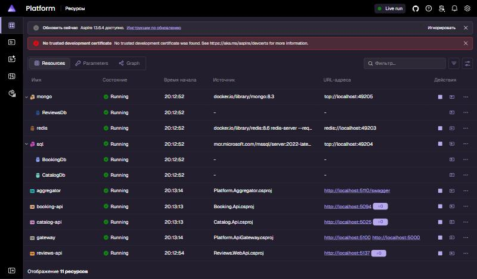

Перший запит фільму — промах кешу (Redis + SQL):

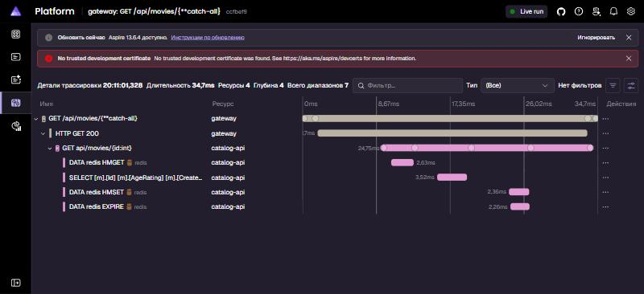

Повторний запит — L1, без SQL-span:

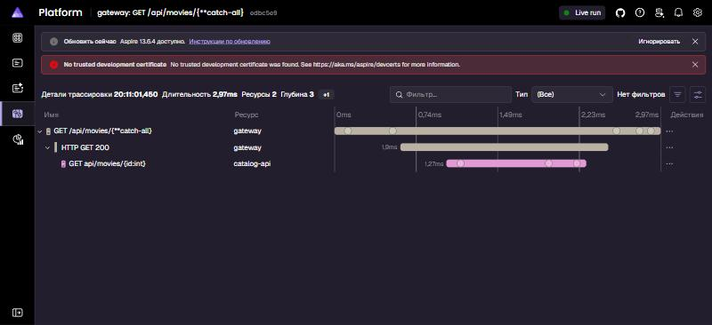

Trace агрегувального запиту з gRPC-spans клієнта й сервера:

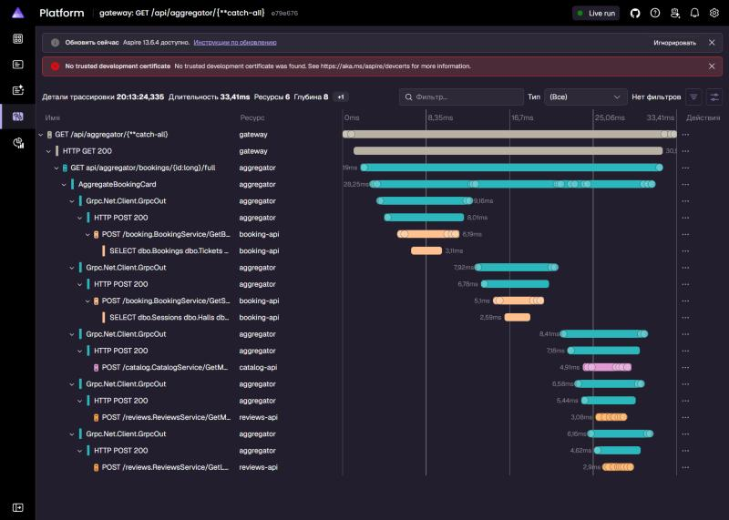

Метрика `cache.hits` (Meter `Catalog.Cache`):

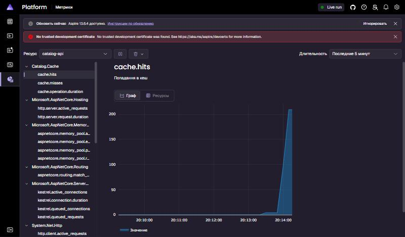

Структуровані логи gRPC і кешу: [`lab06-grpc-and-cache-logs.log`](docs/screenshots/lab06-grpc-and-cache-logs.log).
