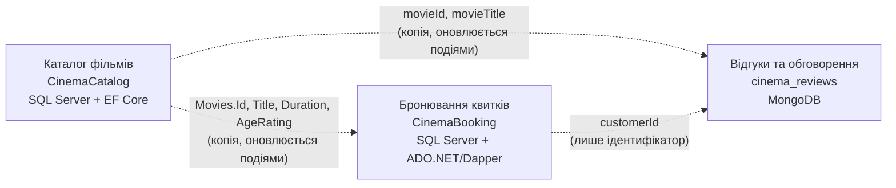
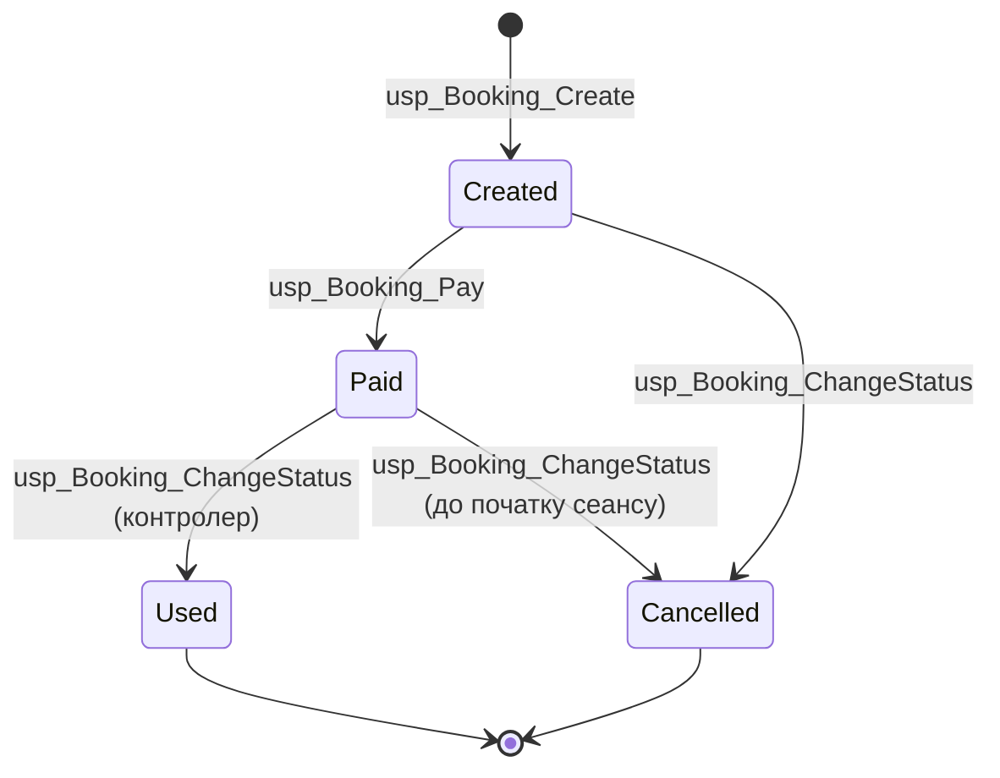

# 1. Предметна область і межі контекстів

## Опис домену

**Кінотеатр «Кадр»** (вигаданий, 2 зали) продає квитки онлайн. **Глядачі** переглядають афішу й інформацію про фільми, бронюють і оплачують місця на сеанс, а після перегляду залишають відгуки й обговорюють фільми. **Адміністратор** веде каталог фільмів і розклад сеансів; **контролер** на вході позначає квитки як використані.

## Три контексти — три бази даних

Пунктир — **логічне посилання за ідентифікатором, без FOREIGN KEY**. Між базами немає ні JOIN-ів, ні спільних таблиць.

| Контекст | Відповідає за | «Свої» сутності |
|---|---|---|
| **Каталог фільмів** | що показує кінотеатр: фільми, жанри, опис, команда | Genre, Movie, MovieDetail, Person, MovieCredit |
| **Бронювання квитків** | транзакційний процес: сеанс → вибір місць → оплата → вхід у зал | Customer, Hall, Seat, Session, Booking, BookingPayment, Ticket (+ копія Movie) |
| **Відгуки та обговорення** | оцінки, рецензії, коментарі, теми обговорень, рейтинги | Review, Discussion, Message, MovieRating |

Власник кожної сутності — рівно один контекст:
* **Movie** належить Каталогу. Бронювання зберігає лише копію чотирьох полів, Відгуки — `movieId` і `movieTitle`.
* **Customer** належить Бронюванню. Відгуки зберігають лише `customerId` і `displayName`.

## Агрегати та життєвий цикл

| Контекст | Агрегат (корінь + частини) | Життєвий цикл |
|---|---|---|
| Каталог | **Movie** + MovieDetail + MovieCredit[] | створено → редагується → soft delete (`IsDeleted`) |
| Каталог | Genre, Person — окремі агрегати-довідники | |
| Бронювання | **Booking** + BookingPayment (1:1) + Ticket[] | `Created → Paid → Used`, `Created/Paid → Cancelled` (лише до початку сеансу) |
| Бронювання | Hall + Seat[]; Session; Customer | |
| Відгуки | **Review** + comments[] (вбудовані) | створено → коментується, лайкається |
| Відгуки | **Discussion** + lastMessages[]; Message — окремо | тема росте необмежено → повідомлення в окремій колекції |
| Відгуки | **MovieRating** — read model | перераховується агрегацією |

## Технологія для кожного контексту

| Проєкт | Контекст | Технологія | Чому |
|---|---|---|---|
| №1 | Бронювання | SQL Server + процедури, ADO.NET & Dapper | гроші та місця: транзакції, блокування (не продати місце двічі), строгі обмеження |
| №2 | Каталог | SQL Server + EF Core Code First | багато зв'язаних сутностей, усі типи зв'язків, міграції |
| №3 | Відгуки | MongoDB | відгуки різної структури, вбудовані коментарі, швидке читання рейтингів |

## Вибір первинних ключів

* **BIGINT IDENTITY** — `Bookings`, `Customers`, `Sessions`, `Movies` (Каталог). Записи вставляються з одного джерела (своєї БД), послідовні ключі компактні й не фрагментують кластерний індекс.
* **INT IDENTITY** — малі довідники (`Halls`, `Seats`, `Genres`, `People`).
* `Movies.Id` у CinemaBooking **без IDENTITY**: значення приходить із Каталогу.
* **GUID** тут не потрібен: ідентифікатори не генеруються в кількох місцях одночасно. У MongoDB використовується `ObjectId`, а в `movieRatings` — природний ключ `_id = movieId`.
