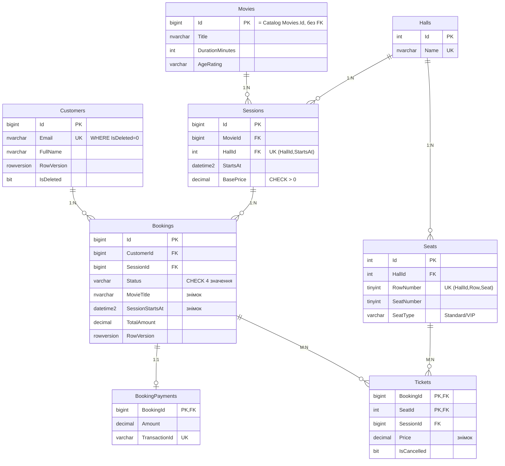

# 2. Проєкт №1 — CinemaBooking (SQL Server + ADO.NET & Dapper)

Скрипти: [`src/Booking/db`](../src/Booking/db). ERD для dbdiagram.io: [`docs/erd/booking.dbml`](erd/booking.dbml).

## ERD

| Зв'язок | Де | Як |
|---|---|---|
| **1:1** | Bookings ↔ BookingPayments | `BookingPayments.BookingId` — і PK, і FK |
| **1:N** | Customers → Bookings, Sessions → Bookings, Halls → Seats/Sessions, Movies → Sessions | FK на боці «багатьох» |
| **M:N** | Bookings ↔ Seats через **Tickets** | складений PK (BookingId, SeatId) + власні поля `Price`, `IsCancelled` |

## Обмеження та каскади

* **CHECK**: формат email і телефону, статус з 4 значень, ціни > 0, тривалість фільму, вікові рейтинги, ряди/місця.
* **UNIQUE**: email глядача (лише серед не видалених), назва залу, фізичне місце `(HallId, Row, Seat)`, `(HallId, StartsAt)` для сеансів, `TransactionId` оплати.
* **DEFAULT**: `Status = 'Created'`, `SeatType = 'Standard'`, аудитні дати, `IsDeleted = 0`.
* **Каскади усвідомлено**: `ON DELETE CASCADE` лише всередині агрегату бронювання (оплата, квитки). `Bookings → Customers` і `Bookings → Sessions` без каскаду, бо історія бронювань не повинна зникати.

## Індекси — кожен під конкретний запит

| Індекс | Запит / правило |
|---|---|
| `UX_Customers_Email` (фільтрований `IsDeleted = 0`) | вхід / пошук глядача за email |
| `IX_Sessions_Movie_StartsAt` INCLUDE (HallId, BasePrice) | розклад фільму |
| `IX_Bookings_Customer` (CustomerId, CreatedAt DESC) INCLUDE (…) WHERE IsDeleted = 0 | «мої бронювання» — покриваючий |
| `IX_Bookings_Session_Unpaid` WHERE Status = 'Created' | касир: неоплачені бронювання сеансу |
| `UX_Tickets_SessionSeat_Active` (SessionId, SeatId) WHERE IsCancelled = 0 | **не продати одне місце двічі**; скасовані квитки місце не займають |
| UNIQUE `(HallId, RowNumber, SeatNumber)`, `(HallId, StartsAt)` | цілісність довідників + пошук місця / сеансу |

## Збережувані процедури (6)

| # | Процедура | Тип | Що робить |
|---|---|---|---|
| 1 | `usp_Booking_Create` | бізнес, транзакція | перевіряє сеанс (ще не почався), місця (належать залу, вільні — `UPDLOCK, HOLDLOCK`), рахує ціну (VIP × 1.5), створює бронювання й квитки |
| 2 | `usp_Booking_Pay` | бізнес, транзакція | `Created → Paid`, перевіряє суму, створює запис 1:1 в `BookingPayments` |
| 3 | `usp_Booking_ChangeStatus` | бізнес, транзакція | `Paid → Used`, `Created/Paid → Cancelled`; **недопустимий перехід → `THROW 50002`**; опційно перевіряє `RowVersion` |
| 4 | `usp_Booking_GetById` | READ | картка бронювання + квитки |
| 5 | `usp_Bookings_GetPage` | READ, пошук | фільтри + пагінація `OFFSET/FETCH` |
| 6 | `usp_Session_GetSeatMap` | READ | схема залу: вільні/зайняті місця |

Шаблон транзакційних процедур: `SET XACT_ABORT ON` → `BEGIN TRY / BEGIN TRANSACTION` → перевірки з `THROW 50xxx` → зміни → `COMMIT`; у `CATCH`: `ROLLBACK` + `THROW`.

## Аудит, soft delete, конкурентність

* `CreatedAt/CreatedBy/UpdatedAt/UpdatedBy` у Customers, Sessions, Bookings; `IsDeleted` у Customers і Bookings.
* **RowVersion** у Customers і Bookings. Глядача може одночасно редагувати він сам і адміністратор, бронювання — касир і контролер. Без RowVersion пізніший запис тихо затер би зміни попереднього.
* Короткі песимістичні блокування (`UPDLOCK`) у процедурах захищають від продажу одного місця двом глядачам.

## Права (`005_security.sql`)

Логін `booking_app` має користувача **лише в CinemaBooking**. Роль `booking_service` дає: `EXECUTE` процедур, CRUD (без DELETE) глядачів, читання довідників. Пряма зміна `BookingPayments` заборонена (`DENY`).
