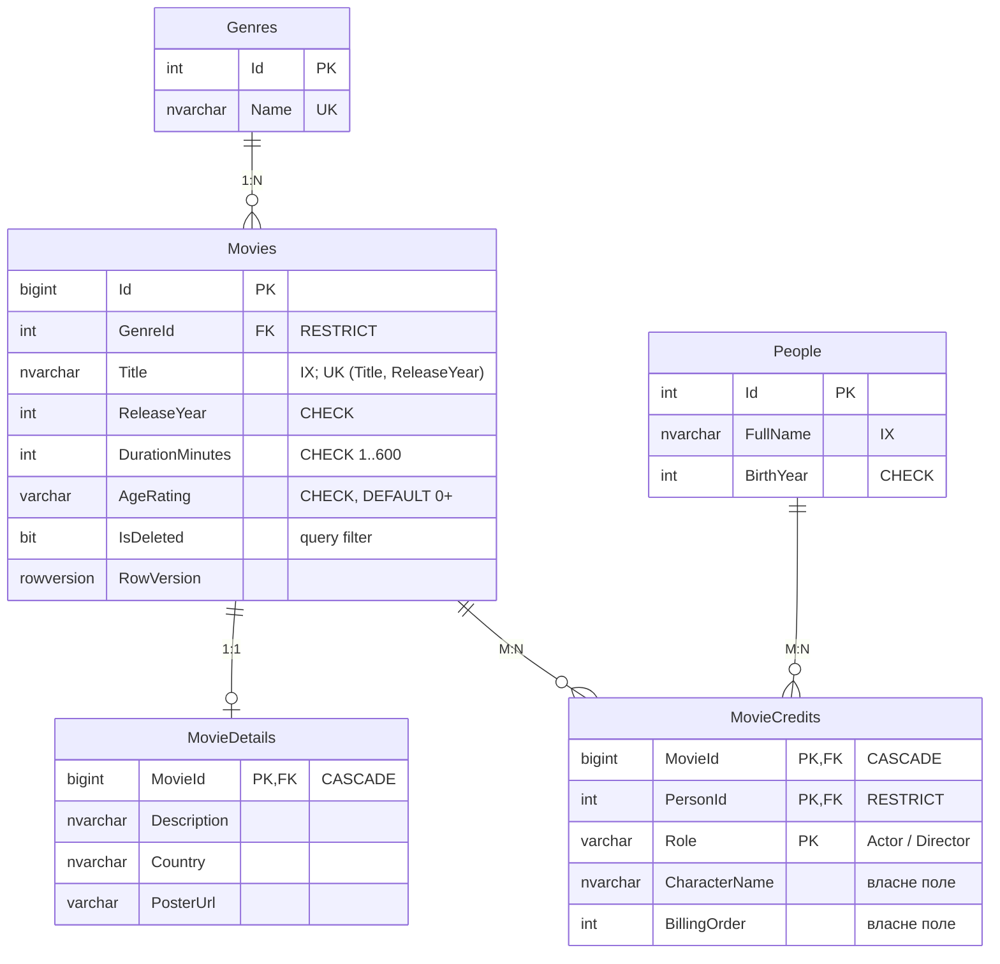

# 3. Проєкт №2 — CinemaCatalog (SQL Server + EF Core Code First)

Код: [`src/Catalog/Catalog.Data`](../src/Catalog/Catalog.Data). DDL: [`db/p2/schema.sql`](../db/p2/schema.sql), seed: [`db/p2/seed.sql`](../db/p2/seed.sql). ERD для dbdiagram.io: [`docs/erd/catalog.dbml`](erd/catalog.dbml).

## ERD (5 сутностей)



| Зв'язок | Fluent API |
|---|---|
| **1:N** Genre → Movie | `HasOne(m => m.Genre).WithMany(g => g.Movies).OnDelete(Restrict)` — жанр із фільмами видалити не можна |
| **1:1** Movie ↔ MovieDetail | `HasKey(d => d.MovieId)` + `HasOne().WithOne().HasForeignKey<MovieDetail>()` — PK = FK |
| **M:N** Movie ↔ Person | проміжна сутність **MovieCredit** з власними полями `Role`, `CharacterName`, `BillingOrder`; ключ `(MovieId, PersonId, Role)`, тож одна людина може бути і режисером, і актором фільму |

## Ключі, обмеження, індекси ([`CatalogDbContext.cs`](../src/Catalog/Catalog.Data/CatalogDbContext.cs))

* **PK**: `int`/`bigint IDENTITY`; складений PK у `MovieCredits`.
* **UNIQUE**: `Genres.Name`, `(Movies.Title, ReleaseYear)`.
* **CHECK**: тривалість, рік випуску, віковий рейтинг, роль, порядок у титрах, рік народження.
* **Індекси під запити**: `Movies.Title` — пошук за назвою; `(GenreId, ReleaseYear) WHERE IsDeleted = 0` — фільми жанру; `People.FullName` — пошук людини; FK-індекси EF створює автоматично (фільмографія людини).
* **Аудит**: `CreatedAt/By`, `UpdatedAt/By` заповнює перевизначений `SaveChangesAsync`. **Soft delete**: `Remove(movie)` → `IsDeleted = 1` + глобальний `HasQueryFilter`. **Конкурентність**: `Movie.RowVersion` (`IsRowVersion()`).

## Seed-дані ([`db/p2/seed.sql`](../db/p2/seed.sql), [`CatalogSeed.cs`](../src/Catalog/Catalog.Data/CatalogSeed.cs))

6 жанрів, 6 фільмів (вигадані), опис кожного, 8 людей, 16 записів команди. `seed.sql` ідемпотентний (`INSERT … WHERE NOT EXISTS`). Ті самі дані задано в моделі EF через `HasData`, тож вони потрапляють і в міграцію. `Movies.Id` 1–6 збігаються з копією в CinemaBooking і з `movieId` у MongoDB.

## Два способи створити схему (результат однаковий)

1. **SQL-скрипти** `db/p2/schema.sql` + `seed.sql` (основний, використовує `deploy.ps1`). `schema.sql` записує в `__EFMigrationsHistory` обидві міграції як застосовані.
2. **Міграції EF Core**: `dotnet ef database update` на порожньому сервері.

## Міграції

| Міграція | Зміна |
|---|---|
| `InitialCreate` | 5 таблиць, обмеження, індекси, seed (`HasData`) |
| `AddMovieIsDeletedDefault` | `DEFAULT 0` для `Movies.IsDeleted` — приклад еволюції схеми |

```bash
dotnet ef migrations add <НазваЗміни> --project src/Catalog/Catalog.Data -o Migrations
```

```bash
dotnet ef database update --project src/Catalog/Catalog.Data
```

```bash
dotnet ef migrations script --idempotent --project src/Catalog/Catalog.Data -o catalog_migrations.sql
```

Реалізація сервісу на EF Core — у Лаб. 03.
