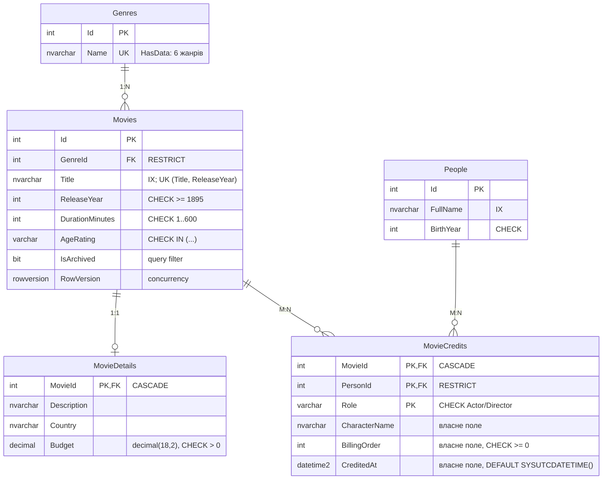

# 3. Проєкт №2 — CinemaCatalog (SQL Server + EF Core Code First)

* **Лаб. 01 — проєкт схеми:** [`db/p2/schema.sql`](../db/p2/schema.sql), [`db/p2/seed.sql`](../db/p2/seed.sql), ERD для dbdiagram.io: [`docs/erd/catalog.dbml`](erd/catalog.dbml).
* **Лаб. 03 — реалізація на EF Core:** [`Services/Catalog`](../Services/Catalog). Модель — [`Catalog.Domain/Entities`](../Services/Catalog/Catalog.Domain/Entities), конфігурації Fluent API — [`Catalog.Dal/Configurations`](../Services/Catalog/Catalog.Dal/Configurations), міграції — [`Catalog.Dal/Migrations`](../Services/Catalog/Catalog.Dal/Migrations) (+ SQL-скрипт `Migrations/Scripts/InitialCreate.sql`).

Модель у Лаб. 03 розвиває проєкт з Лаб. 01: ключі `int`, м'яке видалення через `IsArchived`, бюджет фільму `decimal(18,2)`, дата додавання в титри `CreditedAt` (власне поле M:N). Робоча БД сервісу створюється **міграціями**. Скрипти `db/p2` лишаються артефактом проєктування Лаб. 01.

## ERD (5 сутностей, модель EF Core)



| Зв'язок | Fluent API |
|---|---|
| **1:N** Genre → Movie | `HasOne(m => m.Genre).WithMany(g => g.Movies).OnDelete(Restrict)` — жанр із фільмами видалити не можна |
| **1:1** Movie ↔ MovieDetail | `HasOne(m => m.Detail).WithOne().HasForeignKey<MovieDetail>(d => d.MovieId)` — PK = FK |
| **M:N** Movie ↔ Person | явна проміжна сутність **MovieCredit**, складений ключ `(MovieId, PersonId, Role)`, власні поля `CharacterName`, `BillingOrder`, `CreditedAt` |

## Ключі, обмеження, індекси

* **PK**: `int IDENTITY`; складений PK у `MovieCredits`.
* **UNIQUE**: `Genres.Name`, `(Movies.Title, ReleaseYear)`.
* **CHECK**: тривалість, рік випуску, віковий рейтинг, бюджет, роль, порядок у титрах, рік народження.
* **Індекси під запити**:
  * `Movies.Title` — пошук за назвою;
  * `(GenreId, ReleaseYear) WHERE IsArchived = 0` — фільми жанру;
  * `People.FullName` — пошук людини;
  * `MovieCredits (PersonId, Role, BillingOrder)` — фільмографія й головні ролі.
* **Конкурентність**: `Movie.RowVersion` (`IsRowVersion()`); застарілий RowVersion у PUT → 409.
* **Бізнес-правила в сутностях**: приватні setter-и, валідація в конструкторі, зміни лише методами (`ChangeDuration`, `AddCredit`, `Archive`…).

## Сідінг

* **Статичний** — `HasData` у `GenreConfiguration`: 6 жанрів з фіксованими Id потрапляють у міграцію.
* **Програмний** — [`DbInitializer`](../Services/Catalog/Catalog.Dal/Seeding/DbInitializer.cs) після `MigrateAsync()` у `Program.cs`: 8 людей, 6 фільмів з описами й титрами. Ідемпотентний: якщо фільми вже є, він нічого не робить. Вимикається параметром `Database:SeedOnStartup`, у Production не виконується.

## Міграції

```bash
dotnet ef migrations add <НазваЗміни> --project Services/Catalog/Catalog.Dal --startup-project Services/Catalog/Catalog.Api -o Migrations
```

```bash
dotnet ef database update --project Services/Catalog/Catalog.Dal --startup-project Services/Catalog/Catalog.Api
```

```bash
dotnet ef migrations script --idempotent --project Services/Catalog/Catalog.Dal --startup-project Services/Catalog/Catalog.Api -o Services/Catalog/Catalog.Dal/Migrations/Scripts/InitialCreate.sql
```

Під час запуску Catalog.Api міграції застосовуються автоматично (`Database:MigrateOnStartup`).
