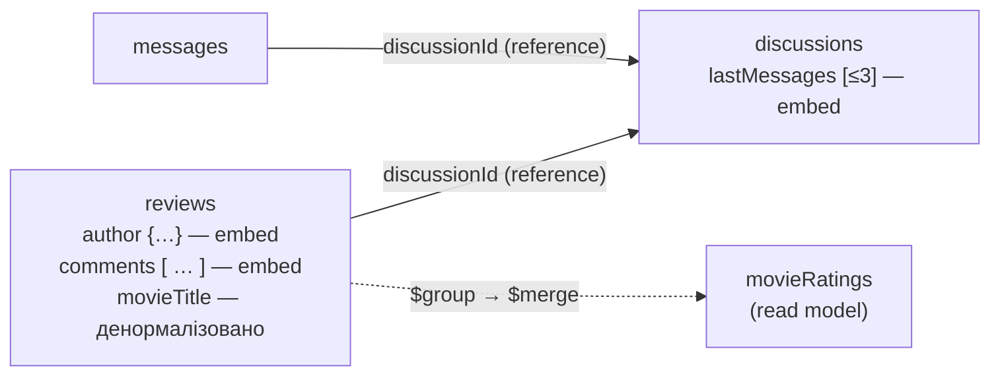

# 4. Проєкт №3 — cinema_reviews (MongoDB)

Скрипти: [`db/p3`](../db/p3). Приклади документів у JSON (Extended JSON, вивантажено `mongoexport`): [`docs/samples`](samples).

**Лаб. 04 — реалізація:** мікросервіс [`Services/Reviews`](../Services/Reviews) (Clean Architecture, CQRS + MediatR) працює саме з цими колекціями `reviews`, `discussions`, `messages`:
- структура документів та сама: BsonClassMap у `Reviews.Infrastructure/Persistence/MongoMappings.cs`;
- імена індексів збігаються з `collections.js`;
- сід-дані — файли `docs/samples/*.json`.

Додано текстовий індекс `tx_reviews_text` (пошук) та `ix_messages_discussion_cursor` (курсорна пагінація), а також поле `version` для оптимістичної конкурентності. Колекція `movieRatings` лишається read model з Лаб. 01; API рахує рейтинг агрегацією на льоту (`GET /api/movies/{movieId}/rating`).

## Колекції (4)

| Колекція | Що зберігає | Прийом моделювання |
|---|---|---|
| `reviews` | відгуки трьох видів: `quick` (лише оцінка), `full` (заголовок, текст, фото, коментарі), `critic` (публікація, плюси/мінуси) | **embedding** (`author`, `comments[]`), **reference** (`discussionId`), **денормалізація** (`movieTitle`), **гнучка схема** |
| `discussions` | теми обговорення фільму | **гібрид**: останні 3 повідомлення вбудовано в `lastMessages[]`, усі — в `messages` |
| `messages` | повідомлення тем, яких може бути тисячі | **reference** `discussionId` (+ `replyTo` для відповідей) |
| `movieRatings` | готовий рейтинг фільму | **денормалізація / read model**: `_id = movieId`, перераховується агрегацією `$merge` |



Коли що: **вбудовуємо** те, що невелике і завжди читається разом із документом (автор, кілька коментарів під відгуком). **Посилаємося** на те, що може рости без меж (повідомлення довгого обговорення).

## Гнучка схема: різні поля в одній колекції

| kind | поля, яких немає в інших видах |
|---|---|
| `quick` | — (лише `rating`) |
| `full` | `title`, `text`, `photos`, `comments`, `discussionId`, `hasSpoilers` |
| `critic` | `publication`, `pros`, `cons` |

Перевірка: `db.reviews.find()` повертає документи з різними наборами полів; запит 2 у `db/p3/queries.js` виводить поля кожного виду.

## Приклад документа (`reviews`, kind = full)

```json
{
  "_id": { "$oid": "670000000000000000000001" },
  "movieId": 1,
  "movieTitle": "Карпатський експрес",
  "author": { "customerId": 1, "displayName": "Олена К." },
  "kind": "full",
  "rating": 5,
  "title": "Найкращий фільм осені!",
  "text": "Неймовірні краєвиди Карпат і закручений сюжет. Рекомендую всім.",
  "hasSpoilers": false,
  "photos": ["https://cdn.cinema-kadr.example/reviews/r1-1.jpg"],
  "comments": [
    { "author": "Тарас М.", "text": "Згоден, фінал — вогонь!", "createdAt": { "$date": "2026-10-02T19:10:00Z" } }
  ],
  "discussionId": { "$oid": "670000000000000000000d01" },
  "likes": 14,
  "createdAt": { "$date": "2026-10-02T18:30:00Z" }
}
```

## Валідація та індекси

* `db/p3/collections.js` — `$jsonSchema` для кожної колекції (оцінка 1..5, обов'язкові поля, типи). Скрипт ідемпотентний: створює колекцію або оновлює валідатор (`collMod`).
* `db/p3/collections.js` — індекси під запити: відгуки фільму (`movieId, createdAt`), «мої відгуки» (`author.customerId`), **унікальний** `(movieId, author.customerId)` — один відгук глядача на фільм, теми фільму, повідомлення теми, топ рейтингів.

## Запити (`db/p3/queries.js`)

1. `$group` + `$merge` → рейтинги в `movieRatings` · 2. різні поля різних видів відгуків · 3. пагінація · 4. відгук із вбудованими коментарями · 5. `$lookup` відгук → обговорення → повідомлення · 6. стрічка тем (гібрид) · 7. атомарне `$push` + `$inc` · 8. валідатор і унікальний індекс відхиляють погані дані · 9. оновлення денормалізованої назви фільму за подією з Каталогу.
